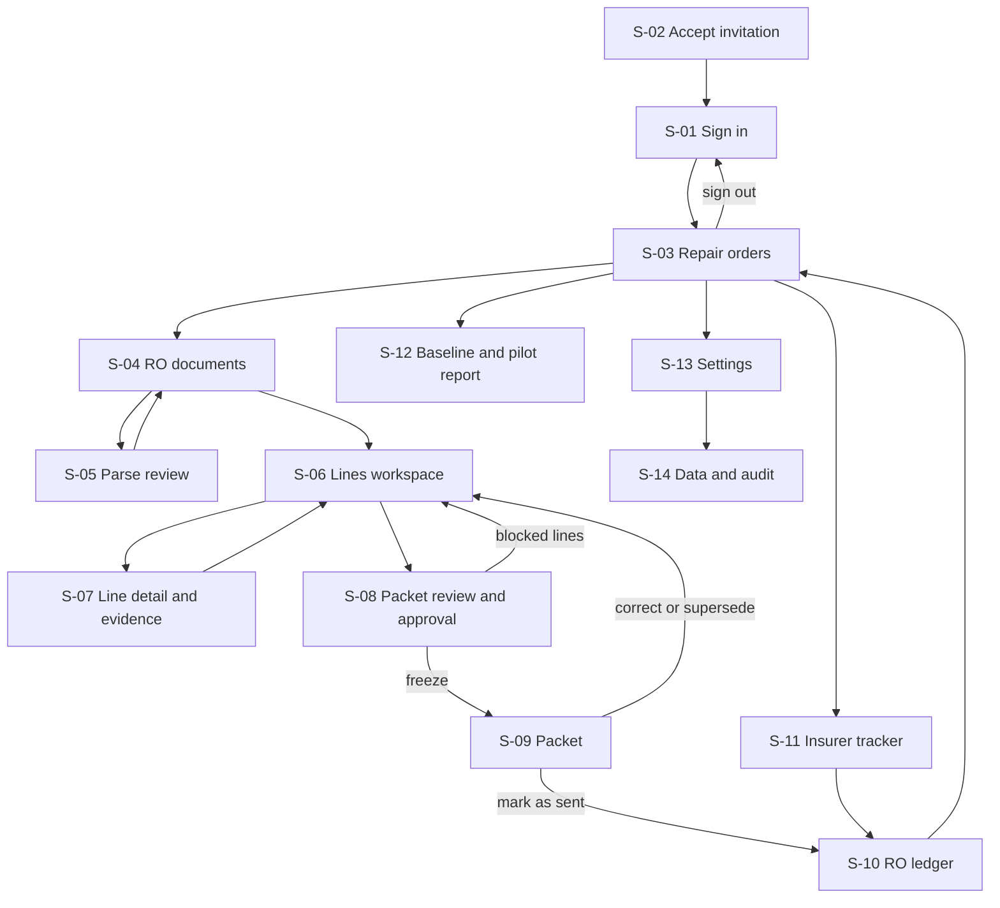

# App flow — SupplementPacket

Proposed MVP screens and routes. Requirements `MH-nn`: [PRD section 6](PRD.md#6-must-haves). Roles: [PRD section 5](PRD.md#5-buyer-users-and-roles). Visual treatment: [design.md](design.md). Endpoints: [TRD 8.1](TRD.md#81-api-contracts).

## 1. Screen inventory

| ID | Screen | Route | Roles | Requirement |
|---|---|---|---|---|
| S-01 | Sign in | `/login` | Anyone | MH-10 |
| S-02 | Accept invitation | `/invite/{token}` | Invitee | MH-10 |
| S-03 | Repair orders | `/ros` | Owner, Estimator, Office, Operator | MH-01, MH-12 |
| S-04 | RO documents | `/ros/new`, `/ros/{id}/documents` | Owner, Estimator, Operator | MH-01, MH-12 |
| S-05 | Parse review | `/ros/{id}/documents/{docId}` | Owner, Estimator, Operator | MH-02 |
| S-06 | Lines workspace | `/ros/{id}/lines` | Owner, Estimator, Operator; Office read-only | MH-03, MH-04, MH-06 |
| S-07 | Line detail and evidence | `/ros/{id}/lines/{lineId}` | Same as S-06 | MH-05, MH-06 |
| S-08 | Packet review and approval | `/ros/{id}/packets/new` | Owner, Estimator; Operator read-only | MH-06 |
| S-09 | Packet | `/ros/{id}/packets/{packetId}` | Owner, Estimator; others read-only | MH-07 |
| S-10 | RO ledger | `/ros/{id}/ledger` | Owner, Estimator (responses), Office (payments) | MH-08 |
| S-11 | Insurer tracker | `/tracker` | Owner, Estimator, Office | MH-08 |
| S-12 | Baseline and pilot report | `/pilot` | Owner, Estimator, Office read; Office and Owner edit the baseline and counts; Operator reads with a grant | MH-09 |
| S-13 | Settings | `/settings` | Owner | MH-10, MH-11 |
| S-14 | Data and audit | `/settings/data` | Owner | MH-10, MH-11 |

Sign-out is a header action on every signed-in screen; it ends the server session and returns to S-01. An unknown route shows "Page not found" with a link to S-03. There is no screen for creating a shop or a pilot: the vendor provisions the tenant, its first location, the Owner invitation and the pilot record ([TRD 8.1](TRD.md#81-api-contracts), provisioning), and the Owner starts at S-02.

## 2. Navigation

Inside an RO, a step bar (Documents, Lines, Packet, Ledger) shows which steps are complete and links to each.

## 3. Screens

### S-01 Sign in
- **Story:** as a shop user I sign in with my password and, if enabled, my authenticator code.
- **Entry:** not signed in. **Inputs:** email, password, 6-digit code. **Visible:** product name, "Forgot password".
- **Actions and destinations:** sign in → the page originally requested, else S-03; forgot password → email with a reset link valid 30 minutes.
- **Acceptance:** wrong credentials give one generic message; after 5 failures the account waits 15 minutes and the screen says so; a reset never signs the user in without the code when TOTP is enabled.

### S-02 Accept invitation
- **Story:** as an invited user I set my password and authenticator.
- **Entry:** unexpired, unused token. **Inputs:** password (12 or more characters, paste allowed), TOTP setup (required for Owner and Estimator).
- **Acceptance:** an expired or used token shows "This invitation has expired. Ask your shop owner to send a new one." and no form.

### S-03 Repair orders
- **Story:** as an Estimator I see my open ROs and what each needs next.
- **Visible:** RO number, vehicle, insurer, step reached, running or failed jobs, three ledger totals, last activity. Filters: open or closed, insurer, "needs my approval", "awaiting response".
- **Actions:** New RO → S-04; open an RO → its furthest incomplete step.
- **Acceptance:** an empty list shows "No repair orders yet" and one New RO button; filters are kept in the URL; other tenants' ROs never appear.

### S-04 RO documents
- **Story:** as an Estimator I create the RO and upload both estimates.
- **Inputs:** RO number (required), location, insurer (pick, add, or "not provided"), claim number, adjuster name and email (each optional), two PDF pickers typed insurer estimate and shop estimate, source system.
- **Visible:** document versions with upload time and job state.
- **Actions:** Upload → job starts, row shows "Reading estimate…"; open a document → S-05; Continue to lines → S-06 (enabled when both types have a current parse that is reconciled, confirmed or manual).
- **Acceptance:** a non-PDF or a file over 25 MB is refused before upload with the reason; uploading the same file twice shows "Already uploaded as version n"; a failed parse offers Retry and "Enter lines manually"; one document failing never disables the other.

### S-05 Parse review
- **Story:** as an Estimator I check the parsed lines against the PDF and fix them.
- **Visible:** PDF page on the left, parsed lines on the right with page and line of origin; printed total, parsed total and the difference; status chip Reconciled, Unreconciled or Manual.
- **Actions:** edit, add or delete a line; "Confirm totals" with a typed reason when the difference is explained; "Re-read with latest parser".
- **Acceptance:** the difference recalculates on every edit; Unreconciled blocks the packet (S-08) but not editing, the diff, or the other document; every edit is in the history.

### S-06 Lines workspace
- **Story:** as an Estimator I review every difference and checklist prompt and decide what to request.
- **Entry:** both documents usable. **Visible:** table of lines with category, description, insurer value, shop value, requested amount, origin badge, evidence count, status; a "Needs review" group for unmatched lines; checklist panel filtered by repair type; running requested total of approved lines.
- **Actions:** Run or re-run comparison; edit amount or description; Approve; Exclude; resolve a needs-review line by pairing it or converting it to a manual line; add a checklist item; add a manual line; select several lines → Exclude selected (the dialog lists each line and its amount); there is no batch approval, each line is approved singly; open a line → S-07; Review packet → S-08.
- **Acceptance:** a needs-review line cannot be approved and is not in any total; it does not prevent approving other lines; changing an approved line, its evidence or a source line it depends on, or re-running the comparison so that it changes, shows "Approval removed because the line changed"; after a conflict message focus moves to that line's message; the Operator sees Approve and Exclude disabled with "Only the shop's estimator can approve"; a second user's change produces "This line changed since you opened it. Reload line."

### S-07 Line detail and evidence
- **Story:** as an Estimator I attach photos and references and write the explanation.
- **Inputs:** photos (multi-select) with two questions that have no default: "taken by our shop" (if no, a note saying who took them) and a tick box "these are photos of this vehicle, not screenshots or copies of repair procedures, estimating guides or other licensed documents"; reference fields (material type, publisher, title, identifier, date accessed, and URL only for openly published material); explanation, under the notice "Describe in your own words. Do not paste procedure or guide text."; optional "Suggest wording" when AI consent is on.
- **Visible:** both source lines with PDF location, photo thumbnails with per-file state, references, history.
- **Acceptance:** each photo shows its own progress and result; a failed photo can be retried alone; the same photo added twice is attached once; the reference form has no file field, and hides the URL field for subscription-portal procedures and estimating guides; adding, removing or editing any evidence on an approved line returns it to draft and says so; an upload without the tick is refused; a suggested wording appears in the edit box labelled "Suggestion — edit before saving" and is never saved automatically.

### S-08 Packet review and approval
- **Story:** as an Estimator I see exactly what will go in the packet before it is frozen.
- **Entry:** at least one approved line. **Visible:** every included line with amount, origin, evidence thumbnails and reference titles; excluded lines collapsed; requested total; blockers list (lines in draft, needs-review lines still open, lines changed after approval, unreconciled parse); recipient details or "not provided"; the email draft: generated summary plus one editable paragraph.
- **Actions:** fix blockers → S-06 or S-05; **Freeze packet** (confirmation: "Freeze packet 2 for RO 4471: 9 lines, USD 1,284.50. Frozen packets cannot be edited.").
- **Acceptance:** Freeze is disabled while any blocker exists and each blocker links to its line; the freeze request carries the fingerprint of exactly what this screen displayed; if a line, its evidence, the email draft or the recipient details changed meanwhile, nothing is frozen, the screen reloads with a "Changed since you reviewed" list, and focus moves to that list's heading; an email draft containing a currency amount other than the requested total is refused with the amount named; Operator and Office see the review without the Freeze button.

### S-09 Packet
- **Story:** as an Estimator I download the packet, send it myself and record that.
- **Visible:** status Frozen, Sent or Superseded; PDF preview and download; email draft with Copy; SHA-256 short code; "SupplementPacket does not send this for you."
- **Actions:** Download PDF; Copy email text; **Mark as sent** (date, channel; confirmation repeats line count and total); Undo sent (within 24 hours, with reason); Correct or supersede → new draft from this packet on S-06.
- **Acceptance:** while the PDF renders the page shows "Building PDF…" and Mark as sent is disabled; a sent date in the future, or before the packet was frozen, is refused; superseding keeps the old packet readable and labelled.

### S-10 RO ledger
- **Story:** as an Estimator I record what the insurer answered; as Office I record what was paid.
- **Visible:** three totals side by side (Requested, Insurer approved, Collected) and the gaps between them; per packet, each line with response status, approved amount, reason, date; response documents; payments list.
- **Actions:** set a line's response, including "already approved before we sent"; "Apply to all remaining lines" for a full approval or full denial (dialog lists the lines); attach the response PDF; add a payment (packet it pays, amount excluding tax, date, payer, the remittance document; for an insurer payment covering more than the supplement the screen proposes the supplement share and the user confirms or changes it); reverse a payment; record a repayment to the insurer; close the RO.
- **Acceptance:** approved above requested needs an override reason; collected above approved on a packet needs a reason; a supplement payment without a remittance document is saved but labelled "Recorded, not evidenced" and shown apart from Collected; after a packet is superseded its carried-over responses appear once, on the new packet; a user never edits a payment, only reverses it; after a supersede the payment shows "moved by the system from packet 1 to packet 2" in its history; totals update without reload and the change is announced; closing an RO with lines still at no response asks for confirmation and leaves them as no response.

### S-11 Insurer tracker
- **Story:** as an Owner I see requested, approved and collected by insurer and month.
- **Visible:** table and chart of the three amounts, approval and collection ratios, count of packets awaiting response with business days since sent. Filters in the URL. Export CSV.
- **Acceptance:** an insurer with fewer than 5 packets shows ratios as "n too small"; the reminder age is labelled "your follow-up reminder", not a deadline.

### S-12 Baseline and pilot report
- **Story:** as an Owner I see whether the pilot met its test and what was incremental.
- **Inputs:** the count of insurer-paid ROs closed in the three baseline months and in the pilot window, and the count of baseline ROs that had a supplement, each with a source note; baseline ROs (label, month, insurer, requested, approved, collected, the three dates if known, source note; any amount or date may be left unknown).
- **Visible:** pilot dates; each refund condition as Met or Not met with the packets counted and the entry time of each baseline row; approved dollars to day 60 and evidenced collected to day 90, each beside its baseline expectation and the difference (PM-4, PM-1); PM-2; the formulas in words; a flag when baseline rows lack dates; the completeness share and which incomplete-row rule was applied; "Not computable" with the missing item named when a count or 10 complete baseline rows are absent.
- **Acceptance:** every figure links to the packets behind it; before day 60 the result reads "In progress" with the count so far.

### S-13 Settings
- **Story:** as an Owner I manage users, locations, insurers, retention, AI consent and Operator access.
- **Actions:** invite, change role, deactivate; add or rename a location or insurer; set retention days; grant Operator access with an end date, revoke it; turn AI assistance on with the disclosure text shown.
- **Acceptance:** the last Owner cannot be removed; AI consent is unavailable with the reason shown while the licence question is open.

### S-14 Data and audit
- **Story:** as an Owner I export, take down or delete my shop's data and inspect the history.
- **Actions:** request export; take down a frozen packet that contains licensed material (reason required; the dialog says files are purged, amounts kept, and copies already sent cannot be recalled); request deletion (type the shop name); filter audit events by RO, user, action.
- **Acceptance:** deletion states what is removed, the 30-day completion and the backup expiry; the export link expires after 24 hours.

## 4. States every screen handles

| State | Behaviour |
|---|---|
| Empty | A sentence saying what belongs here and one primary action |
| Loading | Skeleton rows; no layout shift when data arrives |
| Processing | Job chip with state and elapsed time; the page stays usable; state comes from the server, so it survives reload |
| Partial success | "7 of 9 photos added. 2 failed." with a per-file list and Retry failed |
| Validation error | Message beside the field and a summary at the top linking to each field; entered values kept |
| Permission denied | "Your role cannot do this" with the role that can; the action is also refused by the server |
| Not found or other tenant | "Not found"; no hint that the record exists |
| Timeout or offline | "Still working. You can leave this page; the result will be here when you return." Retry is safe |
| Conflict | "Changed since you opened it" with Reload; unsaved text is kept in the field |
| Session expired | Sign-in, then return to the same URL; field text is restored from the server-side draft saved on each field change; nothing typed is kept in browser storage |

## 5. Navigation rules

- **Refresh, Back, Forward:** every screen is rebuilt from the URL and server state; filters and the selected tab live in the URL; Back after a freeze shows the frozen packet, not the editable review (R-18).
- **Deep links:** every route in section 1 opens directly after sign-in; a link to another tenant's record shows Not found.
- **Duplicate submission:** every mutating button is disabled on first activation and the request carries an idempotency key; double-clicking Freeze, Mark as sent or Add payment creates one record.
- **Batch actions:** always list the affected items before confirming, apply per item, and report per item; a retry skips items already done (R-19).
- **Reopening unfinished work:** an RO opens at its furthest incomplete step; draft lines, half-finished evidence and an unfrozen email draft are saved on every field change.

## 6. Irreversible and external actions

| Action | What the user reviews first | Reversal |
|---|---|---|
| Freeze packet | Every included line, amount, evidence, total, blockers (S-08) | None; supersede with a new version |
| Mark as sent (records an external act the user performed) | Line count, total, date, channel | Undo within 24 hours with a reason; later, supersede |
| Record payment | Amount, date, payer, possible-duplicate warning | Reversal entry |
| Take down a frozen packet | Which files are purged, what stays, that sent copies cannot be recalled | None |
| Delete shop data | What is deleted and when; shop name typed | None after purge starts |

The application performs no external action toward an insurer. Sending is done by the Estimator outside the product.
