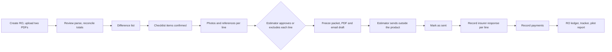

# PRD — SupplementPacket

Labels `[C]`, `[S: SRC-nn]`, `[A]`, `[P]` are defined in [Decision.md section 0](Decision.md#0-how-numbers-are-labelled). Commercial facts live in Decision.md and are cited, not repeated.

## 1. Overview and what the product does

SupplementPacket takes two estimate PDFs for one repair order (the insurer's and the shop's), lists every difference, lets the estimator confirm an omitted-operations checklist, attaches the shop's photos and reference citations to each line, and produces a supplement request packet and an email draft [C]. The estimator approves every line and sees the packet in its final form before it is frozen. The shop sends the packet itself. The product then records what was requested, what the insurer approved and what was collected, per RO, and compares the result with the shop's own baseline.

The product does not send anything to an insurer, does not decide what a repair requires, and does not store or quote licensed repair procedures ([Decision 3.1](Decision.md#31-rights-to-supporting-repair-material)).

## 2. Why now

- Three vendors publicly sell tools for parts of this job ([Decision section 3](Decision.md#3-competitor-overlap-what-was-read-today)); one is reported by a trade-press teaser as launched in August 2026, the others' launch dates are unknown. None advertises collected-cash tracking.
- WAC 284-30-330(4), amended effective 2026-10-18, says an insurer's reasonable investigation may not rely solely on a database such as estimating software [S-arch: SRC-04]. Documented, line-level requests fit that rule; the rule gives the shop no direct right ([Decision section 2](Decision.md#2-market-people-and-current-practice)).

## 3. Goals

| ID | Goal | Measured by |
|---|---|---|
| G-1 | Show whether pilot shops collect incremental cash | PM-1, PM-2 |
| G-2 | Make the packet faster to produce than the manual comparison | WQ-2 |
| G-3 | Never let a line leave the shop without the estimator's approval | FM-1 = 0 |
| G-4 | Keep the refund test computable from documents | PM-4, FM-4 |

## 4. Problem statement

Insurer estimates omit operations the repair needs: scans, calibrations, materials, one-time-use parts [C]. The estimator must find each omission, document it and argue it with the adjuster, and runs out of time, so the shop absorbs the cost or waits [C]. Shops rarely know, per insurer, how much of what they request is approved and how much is actually paid.

## 5. Buyer, users and roles

Buyer: shop owner or general manager [C]. One tenant is one shop business; it has one or more locations.

| Role | Person | May | May not |
|---|---|---|---|
| Owner | Owner or general manager | Everything an Estimator may; manage users, locations, insurers, retention, AI consent, export, deletion and licensed-content takedown; view the pilot report | Approve on behalf of another user; create a tenant or a pilot (the vendor provisions both) |
| Estimator | Lead estimator | Create ROs, upload, correct parses, edit lines, attach evidence, **approve lines, freeze packets, mark sent**, record insurer responses | Manage users or retention |
| Office | Office manager or bookkeeper | Record payments and baseline ROs; read ROs and the tracker | Edit or approve lines; mark sent |
| Operator | The vendor's founder, during hand-run and support | Provision a tenant, its first location, the Owner invitation and the pilot record; prepare drafts in a tenant when the Owner has granted time-limited access; read the ledger | **Approve a line, freeze a packet, mark sent**, change roles, export data |
| Worker (service) | Background jobs | Read and write job-scoped rows for one tenant per job | Approve, send, or cross tenants |

## 6. Must-haves

Priority: P0 = needed for the first software pilot; P1 = needed before resuming outreach. Owner role = who accepts the requirement.

| ID | Priority | User story | Observable acceptance criteria | Owner role |
|---|---|---|---|---|
| MH-01 | P0 | As an Estimator I create an RO and upload the insurer estimate and the shop estimate so that both are held together | Each upload is PDF, at most 25 MB, typed as `insurer_estimate` or `shop_estimate` with a version number; a second file of the same type becomes a new version, never an overwrite; claim number, adjuster and insurer may each be "not provided"; another tenant's user gets 404 for the RO | Estimator |
| MH-02 | P0 | As an Estimator I see the parsed line items and fix them before anything is compared | Parsed lines show page and row of origin; the sum of parsed lines is compared with the printed totals and a mismatch above USD 0.01 sets `unreconciled`; an unreconciled parse cannot feed a packet until the Estimator corrects lines or confirms each total with a reason; a file the parser cannot read falls back to manual entry and blocks nothing else on the RO | Estimator |
| MH-03 | P0 | As an Estimator I get a line-by-line difference list | Each difference has one category (`missing_operation`, `labor_hours_gap`, `refinish_hours_gap`, `part_price_gap`, `part_type_difference`, `rate_difference`, `materials_gap`); amounts are computed in cents with no model involved; a line the matcher cannot pair confidently is `needs_review`, is never counted as matched or as a difference, and never stops the other lines from being compared; rerunning on the same two versions gives the same list | Estimator |
| MH-04 | P0 | As an Estimator I walk a checklist of commonly omitted operations for this repair type and add the ones that apply | Checklist items are operation names from a versioned list; adding one creates a line with origin `checklist`, an amount the Estimator types, and the checklist version; nothing is added without an explicit action per item | Estimator |
| MH-05 | P0 | As an Estimator I attach evidence to a line | A line accepts shop photos (JPEG, PNG, HEIC; location metadata removed) and reference citations (material type, publisher, title, identifier, date accessed, and a URL only for openly published material; the URL field is refused for subscription-portal procedures); every photo batch needs a ticked attestation, not pre-ticked, that the files are the shop's own photos of this vehicle and not screenshots or copies of licensed documents; free-text fields carry a notice not to paste procedure or guide text; there is no procedure-document upload path; a line with no evidence shows "No attached evidence" and needs a written explanation of at least 20 characters to be approved. The product does not claim to detect licensed content ([Decision 3.1](Decision.md#31-rights-to-supporting-repair-material)) | Estimator |
| MH-06 | P0 | As an Estimator I approve or exclude every line, then freeze the packet I have just reviewed | Each line is `draft`, `approved` or `excluded` with the acting user and time; only an Estimator or Owner of the tenant can approve, one line at a time; **any** change to a line's amount, description, explanation, photos, references or attestation, any correction of a source estimate line it depends on, and any comparison re-run that changes it returns it to `draft`; a packet can be frozen only when every included line is `approved`, the parse is reconciled, and the review fingerprint sent with the freeze request (lines, evidence, email draft, recipient details as displayed) equals the server's current one; otherwise the review reloads with the changes listed; freezing stores the snapshot and a SHA-256 of the PDF; a frozen packet never changes except by the takedown in MH-11 | Estimator |
| MH-07 | P0 | As an Estimator I download the packet PDF and copy the email draft, send them myself, and record that I did | The PDF contains only approved lines, their evidence, the requested total and the approver's name; the email draft is generated from the approved lines (RO, claim number if given, line count, requested total) with one free-text paragraph; it is refused if it contains a currency amount other than the requested total; it is part of the review fingerprint; the application has no function that emails, uploads to, or otherwise contacts an insurer; "Mark as sent" asks for date and channel, shows the packet total and line count, and requires confirmation; it can be undone for 24 hours with a reason | Estimator |
| MH-08 | P0 | As an Estimator or Office user I record the insurer's response and payments so that requested, approved and collected are separate per RO | Per packet line: `approved_full`, `approved_partial` with amount, `denied` with reason, `no_response`, or "already approved before sending" (excluded from totals); amounts exclude sales tax; approved per line cannot exceed requested without an override reason; when a packet is superseded, unchanged lines carry their response forward and the old packet stops counting, so approved is never counted twice; payments are never edited by a user (a mistake is reversed); the only change the system makes is to re-attribute a payment to the successor packet on supersede, with an audit event; a supplement payment must name the packet it pays and counts as **collected (evidenced)** only with a remittance document attached, otherwise it shows as "recorded, not evidenced" and is left out of the pilot report; the screen proposes the supplement share of an insurer payment as the amount above the unpaid balance of the original estimate and the Office user confirms it; collected above approved on a packet needs a reason; the RO shows three totals that are never merged; the tracker shows the same by insurer and month | Estimator |
| MH-09 | P1 | As an Owner I see the pilot report: baseline, the refund test and incremental collected cash | The baseline holds the count of insurer-paid ROs closed in the three months before the pilot, the declared count of those with a supplement, and per supplemented RO the requested, approved and collected amounts with dates where known and a source note; with fewer than 10 complete baseline rows or no count, incremental figures show "not computable", never an estimate; the refund test follows [Decision 5.1](Decision.md#51-refund-criterion) and shows each condition as met or not met with the packets counted and the time each baseline row was entered | Owner |
| MH-10 | P0 | As an Owner I control who can do what, and every approval and send is attributable | Roles as in section 5; a tenant, its first location, the Owner invitation and the pilot record are created only by the vendor's provisioning step; the Owner adds locations and insurers; every create, edit, approve, exclude, freeze, mark-sent, response, payment, export, takedown and delete writes an audit event with user, time and before and after values; audit events cannot be edited | Owner |
| MH-11 | P1 | As an Owner I set retention and can export, take down or delete my shop's data | Source PDFs and photos are deleted a configurable number of days after the RO is closed (default 90 [P]); vehicle-owner name, address, phone and policy number are not stored as fields; export produces a ZIP of ledger CSVs and frozen packets; a licensed-content takedown purges a frozen packet's PDF and evidence files and redacts its text, keeping amounts, hash and audit trail; deletion is confirmed by typing the shop name and completes within 30 days including backups expiring | Owner |
| MH-12 | P0 | As an Estimator I always know whether an upload or generation is still running, failed, or partly failed | Every job shows queued, running, succeeded, failed or partly succeeded with a per-file list; retry never duplicates a file or a line; leaving and returning to the page shows the same state | Estimator |

## 7. Current and proposed workflow

**Current** [C]: the estimator prints or opens both estimates, compares them line by line, looks up procedures, emails photos and notes to the adjuster, and follows up from memory. Approved and collected amounts sit in the estimating system and the bank deposit, unconnected.

**Proposed:**

During Phase 0 the same steps are run by hand ([Decision section 5](Decision.md#5-offer-channel-and-pilot)).

## 8. Non-goals

- Sending, submitting or uploading anything to an insurer, adjuster or claims portal.
- Deciding which operations, scans or calibrations a repair requires; writing a repair plan.
- Storing, quoting, linking into subscription portals or summarising OEM procedures or estimating-guide text; uploading procedure pages; detecting licensed content automatically; building any cross-shop database of labour times or prices.
- Integrations with CCC, Mitchell, Audatex or shop management systems; BMS or EMS import [C: PDFs only].
- Billing the vehicle owner; legal arguments or citations of insurance regulations in the packet.
- Predicting approval likelihood; cross-tenant benchmarks.
- Mitchell and Audatex parsers before a paying shop needs one; Google sign-in; SMS; mobile app; multi-shop roll-up beyond the Business tier's three locations.

## 9. Highest-cost user mistake

**An unapproved or unsupported line reaches an insurer.** This is the single highest-consequence failure and is named identically in [CLAUDE.md](CLAUDE.md) and [verification-report-fixing.md](verification-report-fixing.md#1-status-summary). It covers a packet that contains a line the estimator did not approve, or an approved line for work not performed, with a wrong amount, or with evidence from another vehicle.

- **Cost:** RCW 46.71.045 makes it unlawful to retain a customer's payment for work not performed or to charge a customer for unnecessary repairs [S-arch: SRC-05]; which law governs the same request made to an insurer was not read (unverified), but an insurer's fraud referral is the practical exposure; one such packet can end the shop's relationship with an adjuster and the vendor's with the shop.
- **Who reviews:** the Estimator approves each line; the packet review screen shows every line with amount, origin and evidence before freezing ([App-flow S-08](App-flow.md#s-08-packet-review-and-approval)).
- **Prevention:** approval is per line and per user; any change to a line, its evidence or its source resets approval; nothing can be frozen that differs from what the Estimator's review screen showed; frozen packets are immutable; evidence is bound to the RO; the product has no sending function. In the hand-run phase the same rule is kept on paper: drafts are watermarked and a changed draft needs a newly signed approval sheet.
- **Correction after sending:** the Estimator opens the sent packet, records a correction note, creates a superseding packet version that withdraws or amends the line, sends it personally, and marks it sent. The ledger shows the withdrawn amount as requested-then-withdrawn, never as denied. The original stays in the audit trail.

## 10. Dependencies and constraints

| Type | Item |
|---|---|
| Buyer decision | Signed pilot agreement and USD 149 paid before day 1 |
| Sample data | Estimate pairs from pilot shops (target 20 [C]); 10 to 20 baseline ROs per shop |
| Permission | LQ-01 and LQ-06 closed for a shop before any of its real estimates is received; LQ-02 before citations for a publisher ([Decision section 11](Decision.md#11-open-decisions-for-the-founder)) |
| Payment | A payment link for the pilot invoice; no in-app billing in the MVP |
| Format | CCC ONE print-to-PDF with a text layer; scanned images fall back to manual entry |
| Legal | Outreach gate T-0.1.1; no legal advice is given to shops |
| Arithmetic | Money, totals, differences, the refund test and all metrics are deterministic code |
| People | One founder; hand-run capacity 4 shops [A] |

## 11. Success metrics

Window for pilot metrics: packets marked sent on pilot days 1 to 30; approvals counted to day 60; evidenced collections to day 90. Source: the RO ledger (MH-08) and baseline (MH-09). Symbols: N = insurer-paid ROs the shop closed in the window; baseline rates are per insurer-paid RO closed in the three months before the pilot, including ROs with no supplement; incomplete baseline rows are treated as in [Decision 5.1](Decision.md#51-refund-criterion) (lead ruling B1-004 of 2026-11-11, pending owner confirmation, which removes the effect of the 80% threshold: the higher of the complete rows scaled to the declared supplemented count and the highest-row valuation, in which each incomplete or missing row is valued at the highest complete row or at its own supplied amount if higher; incomplete rows therefore never lower the baseline, and rounding resolves in the shop's favour); an insurer approval counts only with a response date in the window and a response document; a packet sent in the window keeps counting through later corrections, exactly once; baseline rows with dates are cut at the same 60 and 90 days, rows without dates count in full and the report is flagged (this understates the increment).

| ID | Kind | Metric | Method and denominator | Baseline | Proposed target [P] |
|---|---|---|---|---|---|
| PM-1 | Commercial | Incremental collected dollars per shop for its 30-day window (the unit used by gate C); also shown per RO | Shop total = evidenced collected on qualifying packets − (baseline collected ÷ baseline insurer-paid ROs) × N. Per RO = shop total ÷ N. Not computable under 10 complete baseline rows or without the two RO counts. The three counts are those in force at the end of pilot day 90 (a later change is flagged and not used) | Each shop's three months before the pilot | Median shop total across the first pilots at least USD 149; at least half of the shops at USD 1,000 or more |
| PM-2 | Commercial | Checklist-originated collected dollars per shop | Collected on a packet × (approved on `checklist` lines ÷ approved on all lines), summed. Labelled an allocation because payments arrive per RO | None needed | Reported; no target until data exists |
| PM-3 | Commercial | Requested, approved, collected by insurer | Three sums and two ratios per insurer per month | Baseline ratios | Reported |
| PM-4 | Commercial | Refund test value: incremental approved dollars per shop | Approved on qualifying packets at day 60 − (baseline approved ÷ baseline insurer-paid ROs) × N, per [Decision 5.1](Decision.md#51-refund-criterion) | Same baseline | At least USD 1,000 [C] |
| CM-1 | Commercial | Paid pilots per 250 shops contacted | Count ÷ shops contacted | 2 [C] | 2 |
| CM-2 | Commercial | Pilots continuing to month 2 (the continuation rate) | Written "continue" ÷ pilots ended | Unknown | 75%, 3 of 4, the rate the economics assume |
| WQ-1 | Workflow quality | Parsed line accuracy | Correct lines ÷ lines on the 20-pair fixture set, judged against hand transcription | n/a | 95% [C] |
| WQ-2 | Workflow quality | Estimator minutes per packet | Self-timed on 5 packets per shop, versus the same shop's manual time on 5 | Manual time measured in discovery | Lower than manual |
| WQ-3 | Workflow quality | Share of suggested lines excluded by the Estimator | Excluded ÷ suggested | n/a | Reported; above 50% triggers a diff review |
| FM-1 | Failure | Lines in a sent packet without an approval event by a permitted user | Audit query, all tenants | n/a | 0 |
| FM-2 | Failure | Sent packets later corrected or withdrawn | Count ÷ sent packets | n/a | Under 2% |
| FM-3 | Failure | Packets frozen from an unreconciled parse | Constraint violations | n/a | 0 |
| FM-4 | Failure | Qualifying packets with no response document at day 60 | Count ÷ qualifying packets | n/a | Under 20% (the refund condition) |
| FM-5 | Failure | Jobs older than 10 minutes in `queued` or `running` | Monitor | n/a | 0 |

## 12. Evidence that would justify expanding the MVP

- **Mitchell or Audatex parser:** a paying or signed shop that uses that system.
- **Procedure page upload or portal links:** written confirmation for a named publisher (LQ-02), a new must-have, and a schema for it; none exists in the MVP.
- **Usage pricing** (USD 5 per packet above 150 [C]): a paying account exceeding its cap in two consecutive months.
- **Multi-shop reporting, integrations:** gate C passed ([Decision section 9](Decision.md#9-stop-rule)) and a Business-tier buyer asking in writing.
- **Approval-likelihood hints:** at least 500 recorded line responses in one tenant, shown only to that tenant.
