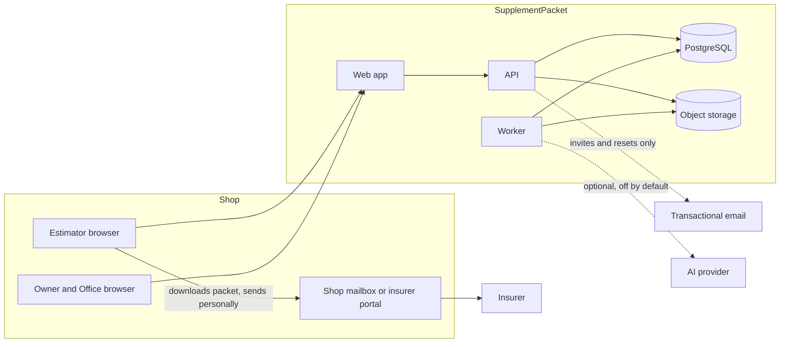
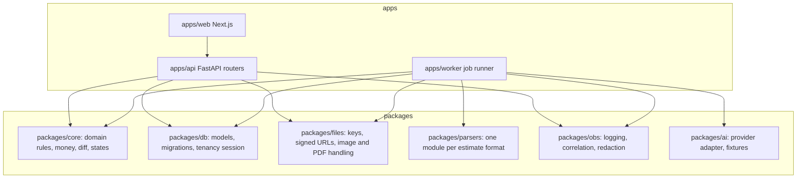
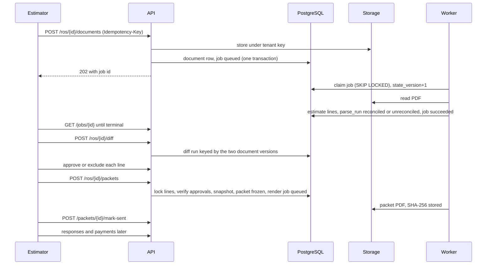
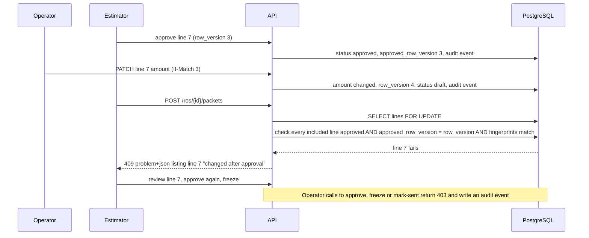

# TRD — SupplementPacket

arc42 order. Everything here is **proposed** unless marked *B1*: build milestone B1 (2026-11-11) implements the API core path, the worker, the database and the packages named in [AGENTS section 11](AGENTS.md#11-utilities-index-b1); everything else is still proposed. Labels are defined in [Decision.md section 0](Decision.md#0-how-numbers-are-labelled). Requirements are in [PRD section 6](PRD.md#6-must-haves); risks `R-nn` are in [verification-report-fixing.md section 5](verification-report-fixing.md#5-production-risk-register).

## 1. Introduction and goals

Turn two estimate PDFs into an estimator-approved supplement packet and a three-amount ledger per RO. Quality goals in order: (1) no line leaves without the estimator's approval; (2) amounts are exact and reproducible; (3) tenants are isolated; (4) a failed job is visible and safely retryable; (5) licensed material is referenced, not stored.

## 2. Constraints

| Constraint | Source |
|---|---|
| Input is exported PDFs only; no estimating-system API | [C] |
| No outbound channel to insurers | [PRD MH-07](PRD.md#6-must-haves) |
| No cross-tenant use of estimate line data; no stored OEM or guide text; no procedure upload path | [Decision 3.1](Decision.md#31-rights-to-supporting-repair-material) |
| One founder operates it; fixed cost budget USD 800 a month [C] | Decision 7.1 |
| US customer data stays in a US region [P] | FD-02 |
| Money, totals, differences, access decisions and report arithmetic are deterministic | SPEC, PRD section 10 |

## 3. Context and scope

External systems: transactional email (to shop users only), optional AI provider, payment link provider (outside the application). The insurer is outside the system boundary and is never called.

## 4. Solution strategy

| Concern | Choice [P] | Why; trade-off |
|---|---|---|
| Frontend | Next.js 15, TypeScript, server-rendered pages calling the API; TanStack Query only for job polling | The brief's suggestion; server rendering keeps state on the server so refresh and deep links work (R-18). Cost: a Node process to run |
| Backend | Python 3.12, FastAPI, Pydantic v2 | PDF and image libraries are strongest in Python. Cost: two languages |
| Database | PostgreSQL 16 with row-level security | Tenancy enforced below the application (R-05) |
| Storage | S3-compatible object storage; MinIO locally | Versioning and lifecycle rules for retention (R-14) |
| Jobs | A `jobs` table polled with `FOR UPDATE SKIP LOCKED`; one worker process from the same package | Volume is about 60 packets a month per shop [C]; a broker would add a service to run. Revisit above 5 jobs a second |
| PDF reading | `pdfplumber` on the text layer; a layout parser per estimating system | Deterministic and testable. Scanned PDFs go to manual entry |
| PDF writing | HTML template rendered with WeasyPrint | One template language for screen preview and PDF |
| AI | Optional extraction assist and wording assist, both off by default ([8.7](#87-ai-functions)) | Avoids disclosing estimate content to a third party before LQ-01 is answered |
| Testing | pytest, Hypothesis, Playwright, axe-core | See [execution-plan section 7](execution-plan.md#7-test-catalogue) |
| Hosting | AWS us-west-2: one small VM running containers (proxy, web, api, worker), managed PostgreSQL with point-in-time recovery, S3 | Managed backups without an operations team. Estimated USD 90 to 120 a month [A], inside the USD 800 fixed cost |
| DevOps | GitHub Actions; images tagged by commit; migrations as a separate deploy step; staging on the founder's existing VPS with synthetic data only | Reuses what the founder has [C] |

**Deferred:** broker-based queue, read replicas, single sign-on, antivirus scanning, a second region, in-app billing, estimating-system integrations.

## 5. Building block view

Rules: `apps/*` import only from `packages/*` public modules; packages never import from apps; `api` and `worker` never import each other (R-04, R-06). `packages/obs` has no web-framework import (R-07). Configuration is one typed settings module in `packages/core` read by both processes (R-06). Money helpers, date helpers and state transitions exist once in `packages/core` (R-03).

## 6. Runtime view

### 6.1 Normal sequence

### 6.2 Highest-consequence failure sequence

The failure is "an unapproved or unsupported line reaches an insurer" ([PRD section 9](PRD.md#9-highest-cost-user-mistake)). Race: the Operator edits a line while the Estimator freezes.

The same refusal covers the other ways a packet could differ from what the Estimator saw: adding, removing or replacing a photo or reference, changing an attestation, correcting a source estimate line, re-running the comparison, or editing the email draft each change the line version or the review fingerprint ([schema](schema.md#3-data-dictionary), `supplement_lines` approval reset rule; `packets.review_fingerprint`), so the freeze returns 409 and the review screen reloads with the changes listed (IT-18). Recovery after a bad packet was already sent: superseding packet version ([PRD section 9](PRD.md#9-highest-cost-user-mistake)); the frozen original is never edited.

## 7. Deployment view

| Aspect | Local | Staging | Production |
|---|---|---|---|
| Start | One command, `make dev`: database, MinIO, api, worker, web, mail catcher, with health checks (R-17). *B1 on the build machine: no Docker, so `make dev` uses the running PostgreSQL 16, starts api (port 8103) and worker directly, stores objects in `.run/storage`, and has no MinIO, web or mail catcher; Redis is not used (AD-03)* | Containers on the founder's VPS | Containers on the VM; managed database; S3 |
| Data | Synthetic fixtures only | Synthetic only | Customer data |
| AI | Recorded fixtures, no network | Provider sandbox key | Off until a tenant Owner consents |
| Email | Mail catcher | Restricted recipient list | Transactional provider |
| Public URL | `http://localhost:3000` | Staging host | `PUBLIC_BASE_URL`, required at start; links are built only from it (R-16) |
| Volumes | Named volumes for database and MinIO | Named volumes, backed up nightly | No state on the VM; database and S3 are managed (R-15) |

- **Deploy (proposed):** CI builds images tagged with the commit; migrations run as their own step and must be backward compatible with the previous image; then api, worker and web are replaced; `/healthz` and `/readyz` gate traffic.
- **Rollback:** redeploy the previous tag; migrations are expand-then-contract so the previous image runs on the new schema; contract steps ship one release later.
- **Backup:** database point-in-time recovery with 7-day retention; S3 versioning with noncurrent versions expiring after 30 days. **Targets (proposed):** data loss at most 5 minutes for the database; restore within 4 hours.
- **Restore:** proposed runbook restores the database to a new instance at a chosen time, repoints the application, and verifies row counts per tenant and the SHA-256 of a sample of frozen packets against storage. Drilled before the first software pilot ([T-7.1.1](execution-plan.md#milestone-m71--release-and-operations)).
- **Alert ownership:** the founder owns every alert during the pilot; alerts go to email and phone. **Incident response:** acknowledge within 1 business hour; if tenant isolation or packet integrity is in doubt, set the application read-only (a configuration flag), notify affected Owners within 72 hours [P], record a post-incident note in the repository.

## 8. Crosscutting concepts

### 8.1 API contracts

REST under `/api/v1`, JSON, errors as RFC 9457 problem documents. Mutations accept `Idempotency-Key`; updates use `If-Match` with `row_version` and return 409 on conflict. Lists are paginated by cursor.

| Area | Endpoints (proposed) | Requirement |
|---|---|---|
| Auth | `POST /auth/login`, `/auth/totp`, `/auth/logout`, `/auth/password-reset`, `/invites/{token}/accept` | MH-10 |
| ROs | `GET, POST /ros`, `GET, PATCH /ros/{id}` | MH-01 |
| Documents | `POST /ros/{id}/documents`, `GET /documents/{id}`, `GET /jobs/{id}`, `POST /jobs/{id}/retry` | MH-01, MH-12 |
| Parse | `GET /documents/{id}/lines`, `POST /documents/{id}/manual-lines` (manual entry fallback, B1), `PATCH /estimate-lines/{id}`, `POST /documents/{id}/reconcile` | MH-02 |
| Lines | `POST /ros/{id}/diff`, `GET, POST /ros/{id}/lines`, `PATCH /lines/{id}`, `POST /lines/{id}/approve`, `POST /lines/{id}/exclude`, `GET /checklist` | MH-03, MH-04, MH-06 |
| Evidence | `POST /lines/{id}/photos` (attestation required), `POST /lines/{id}/references`, `PATCH /references/{id}`, `PATCH /photos/{id}` (attestation answers, B1), `DELETE /evidence/{id}`; each resets the line's approval | MH-05, MH-06 |
| Packets | `GET /ros/{id}/packet-review` (returns the review fingerprint), `POST /ros/{id}/packets` (must carry that fingerprint and, in B1, the per-item components it was computed from, so a 409 can list what changed; it rechecks under the lock that every approver is still an active Owner or Estimator, and a line withdrawn from the previous version is kept as a withdrawn line outside the request), `GET /packets/{id}`, `GET /packets/{id}/pdf` (returns a 5-minute signed link to `GET /packets/{id}/pdf/download`, B1), `POST /packets/{id}/mark-sent`, `POST /packets/{id}/unmark-sent` | MH-06, MH-07 |
| Ledger | `PUT /packet-lines/{id}/response`, `POST /packets/{id}/response-documents`, `POST /packets/{id}/remittance-documents`, `POST /ros/{id}/payments` (a supplement payment names its packet), `POST /payments/{id}/reverse` (full or partial, B1), `GET /ros/{id}/ledger` (B1), `GET /tracker` | MH-08 |
| Pilot | `GET, POST /baseline-ros`, `PATCH /pilots/{id}/counts` (the two baseline counts and the window count; every change is kept as an event), `GET, POST /pilots/{id}/vendor-late-drafts` (one row per late draft with its repair order `ro_id`, optional `packet_id`, reference, request and return times; one per repair order, a repeat gives 409; POST by the vendor Operator only, every shop role reads), `PATCH /pilots/{id}/vendor-late-drafts` (Operator confirms the record is complete), `GET /pilots/{id}/report` (B1: the pilot is named in the path because a tenant can have one pilot per location) | MH-09 |
| Admin | `GET, PATCH /settings`, `GET, POST /users`, `GET, POST /locations`, `GET, POST /insurers`, `GET /audit`, `POST /exports`, `POST /packets/{id}/takedown`, `POST /deletion-requests`, `POST /operator-grants` | MH-10, MH-11 |
| Provisioning (vendor Operator only) | `POST /operator/tenants` (tenant, first location, Owner invitation), `POST /operator/pilots` | MH-10 |

There is deliberately no endpoint that transmits to an insurer. *B1 implements the ROs, Documents, Parse, Lines, Evidence, Packets and Ledger rows (except `GET /tracker`) and the Pilot row. B2 implements Auth as `POST /auth/login` (password step), `POST /auth/totp`, `POST /auth/logout`, `POST /auth/logout-all`, `GET /auth/session` (returns the anti-forgery token), `POST /auth/password-reset`, `POST /auth/password-reset/confirm`, `GET /invites/{token}`, `POST /invites/{token}/totp-setup`, `POST /invites/{token}/accept`; from Admin only `GET, POST /users` (Owner: members and invitations); and `GET /documents/{id}/content`, `GET /photos/{id}/content` (authorised downloads). Provisioning and the rest of Admin are not implemented; tests still create sessions directly in the database (T-2.2.3 in part). IT-01 iterates the route inventory, so every new endpoint is covered automatically.*

### 8.2 Identity

Password (minimum 12 characters, checked against a breached-password list) plus TOTP. TOTP is mandatory for Owners, Estimators and Operators, that is for every role that can approve, freeze, mark sent or enter a tenant, and optional for Office users during the pilot. A new session token is issued on every authentication and the old one is ended. Email is used for invitations and password-reset links, which are recovery and do not replace a factor; there are no emailed sign-in links. Sessions are opaque server-side tokens in a `Secure`, `HttpOnly`, `SameSite=Lax` cookie; 12-hour absolute and 60-minute idle timeout [P]; logout invalidates server-side. *B2 as built:* the cookie is `__Host-sp_session` (Path=/, no Domain); the token is 256 random bits and only its SHA-256 is stored; the password step creates a 5-minute `auth_level=password` session that reaches only `POST /auth/totp`, which ends it and issues a new full session (a user with no TOTP step gets the full session directly); every request other than GET or HEAD needs the `X-CSRF-Token` header (HMAC-SHA256 of the session under `SESSION_KEY`, returned at sign-in and by `GET /auth/session`), and a foreign `Origin` is refused; logout sends `Clear-Site-Data`. Passwords use scrypt (N=2^15, r=8, p=1), 12 to 256 characters, no composition rules, and a short local list of common passwords (the breached-password service is deferred: it needs an outside call). TOTP is RFC 6238 SHA-1, 6 digits, 30 s, one step of drift, each step accepted once; secrets are AES-GCM encrypted under a key derived from `SESSION_KEY` (rotating that key means re-enrolling every authenticator). Rate limits: 10 sign-in requests per email and 30 per client address in 15 minutes; 5 failed passwords or codes for an email lock it for 15 minutes whether or not the account exists; reset requests 3 per email and 20 per address per hour; invitation and reset completion 20 per address in 15 minutes (429 with `Retry-After`). Invitation links are valid 72 hours and reset links 30 minutes, once each; a reset needs the TOTP code when one is enabled, ends every session and does not sign in. A disabled user's sessions stop at the next request. The client address is the socket peer; behind a proxy it must come from the trusted proxy header (deployment, not built). Nothing a user has typed is kept in browser storage; unsaved field text is saved to the server as a draft on every field change. Google sign-in from the brief is deferred.

### 8.3 Tenancy

Every tenant-owned table carries `tenant_id`. The API opens each transaction with `SET LOCAL app.tenant_id` from the session; row-level security policies compare it; the application role cannot bypass them. Workers set the tenant from the job row and process one tenant per job. Object keys start with the tenant ([8.6](#86-files)). Operator access needs an unexpired `operator_grants` row created by the Owner. Cross-tenant requests return 404.

### 8.4 Configuration and secrets

Typed settings from environment variables, validated at start; the process refuses to start without `PUBLIC_BASE_URL`, database URL, storage bucket and session key. *B2:* `STORAGE_BACKEND` (`s3`, or `local` for tests), `S3_ENDPOINT_URL`, `S3_REGION`, `S3_ACCESS_KEY_ID`, `S3_SECRET_ACCESS_KEY` (local MinIO in development, a provider later, by settings only); `SMTP_HOST`, `SMTP_PORT`, `SMTP_FROM`, `SMTP_USERNAME`, `SMTP_PASSWORD`, `SMTP_STARTTLS` (local Mailpit in development); `SESSION_ABSOLUTE_HOURS`, `SESSION_IDLE_MINUTES`. Variable names are in `config/dev.env.example`; local values only in the untracked `.env`. Secrets live in the host's secret store in production and in an untracked local file in development; none in the repository or logs.

### 8.5 Jobs, retries, timeouts, idempotency

| Job | Trigger | Timeout | Retries | Idempotency |
|---|---|---|---|---|
| `parse_document` | Upload | 120 s | 3 with backoff; then `failed`, manual entry offered | Keyed by document id and parser version; replaces only its own `parse_run` |
| `process_photo` | Photo upload | 60 s each | 3 | Keyed by content hash within the line; a batch reports per file (R-19) |
| `render_packet` | Freeze | 120 s | 3; packet stays frozen, PDF pending | Keyed by packet id; same snapshot gives the same hash |
| `build_export` | Owner request | 15 min | 1 | Keyed by request id |
| `retention_sweep` | Daily | 30 min | Next day | Deletes by listing prefixes and rows past expiry; resumable |
| `takedown_purge` (B1) | Owner takedown | 120 s | 3 | Keyed by packet id; deletes only keys under the job's tenant prefix, listed at takedown time |

Job rows carry `state`, `state_version`, `attempt`, `locked_until`, `correlation_id`. Transitions are compare-and-set on `state_version`; a late or duplicate completion that finds a higher version is discarded and logged (R-01). A browser timeout changes nothing: the job continues and the client reads `GET /jobs/{id}`; repeating the upload with the same `Idempotency-Key` returns the original job (R-02). A sweeper returns jobs whose `locked_until` has passed to `queued`.

### 8.6 Files

Key scheme: `t/{tenant_id}/ro/{ro_id}/{purpose}/{document_id}/{sha256}.{ext}` with purpose in `insurer_estimate`, `shop_estimate`, `photo`, `response`, `remittance`, `packet`, `export`; temporary uploads under `tmp/{tenant_id}/{upload_id}` with a 24-hour lifecycle rule (R-13, R-14). File names from users are stored as metadata only. Type is checked by content, size capped at 25 MB per PDF and 15 MB per photo, photos rejected above 40 megapixels and re-encoded with metadata removed. Downloads use signed URLs valid for 5 minutes, built from `PUBLIC_BASE_URL` (R-16). *B2 as built:* objects are stored through the S3 API (`sp_files.S3ObjectStore`, MinIO locally) in a private bucket with no public URL; source documents and photos are downloaded only through `GET /documents/{id}/content` and `GET /photos/{id}/content` with a session (another tenant gets 404), packet PDFs through the 5-minute signed link plus a session. Photo metadata is removed before storage at byte level with the standard library (`sp_files.metadata`): JPEG Exif and XMP (APP1), APP3 to APP13, APP15 and comments; PNG `eXIf`, `tEXt`, `zTXt`, `iTXt` and `tIME`; pixels are not decoded. **Not built:** re-encoding to 2,000 pixels and the 40-megapixel limit (they need an image library), and HEIC metadata removal, so HEIC photos are refused for now with a message to export JPEG (a gap against MH-05, which lists HEIC).

### 8.7 AI functions

| | AI-1 extraction assist | AI-2 wording assist |
|---|---|---|
| Responsibility | Propose line items for a page where the deterministic parser failed reconciliation | Rephrase the Estimator's own note for a line into one to three sentences |
| Input | Page text of the shop's own estimate | Line description, amount, the Estimator's note, reference titles and identifiers. The product cannot tell whether a note contains pasted OEM or guide text ([Decision 3.1](Decision.md#31-rights-to-supporting-repair-material), residual risk), so this function stays off until LQ-01 and LQ-02 are closed |
| Default | Off; Owner consent per tenant; blocked while LQ-01 is open | Off; same consent |
| Output control | JSON schema validation; totals must still reconcile deterministically | May not introduce a number, document identifier or operation absent from the input (string check); otherwise discarded |
| Evaluation fixtures | 20 estimate pairs [C], hand-transcribed; target 95% line accuracy [C]; rerun on every model or prompt change | 30 synthetic line notes with forbidden-token checks |
| Human-review boundary | Every proposed line is `draft` and marked "suggested by AI"; the Estimator corrects and approves | Text is a suggestion in an edit box; nothing is saved without the Estimator's action |
| Fallback | Manual line entry | A fixed template sentence |
| Provider or version change | Model identifier and prompt version are stored per call; a change requires the fixture run to pass before enabling | Same |

Differences, totals, the refund test, metrics, permissions and retention never use a model.

### 8.8 Audit and logging

Audit events are append-only rows written in the same transaction as the change ([schema](schema.md#3-data-dictionary)). Logs are structured JSON with `correlation_id` created at the edge and copied into job rows and retries (R-12). A redaction filter drops claim numbers, VINs, names, amounts, file names and document text; logs carry identifiers and states only.

## 9. Architecture decisions

| ID | Decision | Alternative rejected | Reason |
|---|---|---|---|
| AD-01 | Modular monolith: one API, one worker, shared packages | Microservices | One operator; shared rules must not drift |
| AD-02 | Row-level security for tenancy | Application-only filters | A missed filter must fail closed |
| AD-03 | Database-backed job queue | Redis or SQS | Fewer services at pilot volume |
| AD-04 | Deterministic parser first; AI optional and gated | Model-first extraction | Reproducible amounts; LQ-01 |
| AD-05 | No outbound channel to insurers | Send on the shop's behalf | The estimator must be the sender; removes the worst failure path |
| AD-06 | Licensed material is reference-only; no procedure upload path; no URL for subscription-portal material; attestation on photos; takedown procedure. No automatic detection is claimed | Store uploaded procedure pages (the brief); a per-publisher allow-list (dropped from the MVP in review round 1) | Terms read at SRC-10 and SRC-11 |
| AD-07 | Packets are immutable versions with a content hash | Editable packets | What was sent must be provable |
| AD-08 | Money as integer cents in `BIGINT`; hours as `NUMERIC(6,2)` | Floating point | Exact arithmetic |
| AD-09 | Tenant-prefixed, content-addressed object keys | User file names as keys | Isolation and collision safety |
| AD-10 | AWS us-west-2 for production | The founder's VPS | US data region, managed backups; FD-02 can reverse this |
| AD-11 | Password plus TOTP; no email sign-in links | Email magic links (the brief's "Email") | Email is not an authentication factor (ASVS 6.3.6) |
| AD-12 | No cross-tenant aggregation of line data, including for the checklist | Learn omissions across shops | Licence risk in [Decision 3.1](Decision.md#31-rights-to-supporting-repair-material) |

## 10. Quality requirements

All targets are proposed and unverified.

| Attribute | Workload | Target | Future verification |
|---|---|---|---|
| Parse latency | 5 concurrent uploads of 30-page PDFs | p95 at most 60 s to a terminal state | Load script in [T-6.1.5](execution-plan.md#milestone-m61--test-hardening) |
| Queue age | 25 shops, 60 packets a month each, month-end burst of 20 jobs in a minute | Oldest queued job under 2 minutes | Metric and alert FM-5 |
| Read response | 10 concurrent users on RO list and lines workspace of 150 lines | p95 at most 500 ms | Load script |
| Packet render | 40 photos, 60 lines | p95 at most 30 s | Load script |
| Data loss | Database failure | At most 5 minutes | Restore drill |
| Restore time | Loss of the database instance | At most 4 hours | Restore drill |
| Diff reproducibility | Same two document versions, 100 runs | Identical output | Property test UT-05 |
| Isolation | Two tenants, every endpoint | 0 cross-tenant reads or writes | IT-01 |

## 11. Risks and technical debt

### 11.1 Technical risks

| Risk | Handling |
|---|---|
| Estimate PDF layouts change between versions | Parser version recorded per run; reconciliation check catches silent drift; manual entry fallback |
| Line matching is ambiguous for free-text lines | `needs_review` state; never auto-resolved |
| Licence terms forbid the core input (LQ-01) | Gate before live data; fall back to the vendor's sanctioned sharing route |
| Photo volume inflates storage | Re-encode to at most 2,000 pixels on the long edge; retention sweep |

### 11.2 Accepted debt

Single VM (no high availability); no antivirus scan; TOTP optional for the Office role; no automatic detection of licensed content in photos or free text; manual operator deploys.

### 11.3 Threat model

Sensitive assets: estimate PDFs (vehicle-owner details, VIN, claim numbers), photos, per-insurer ledger amounts, credentials, the audit trail, frozen packets. Trust boundaries: browser to API; API and worker to database; worker to storage; worker to AI provider; Operator into a tenant.

| Abuse case | Proposed control | ASVS 5.0.0 requirement (text read at SRC-21) | Status |
|---|---|---|---|
| User of shop A requests shop B's RO, file or packet by ID | Row-level security, tenant-prefixed keys, 404 | 8.2.2, 8.4.1, 8.3.1 | Planned, not evidence |
| Office or Operator calls approve, freeze or mark-sent | Function-level permission table enforced server-side; audit | 8.2.1 | Planned |
| Malicious or oversized upload | Content-type check, size caps, generated keys, re-encoding | 5.2.1, 5.2.2, 5.3.2 | Planned |
| Known-malware file served back to users | None in the MVP | 5.4.3 | **Not met** (accepted gap, L2) |
| Password guessing or stuffing | Rate limits, lockout with documented behaviour, minimum length | 6.1.1, 6.2.1, 6.3.1 | Implemented in B2 (8.2); `test_b2_rate_limit_and_lockout` |
| Stolen password alone | TOTP, mandatory for Owner, Estimator and Operator | 6.3.3 | **Not met** for the Office role during the pilot (TOTP optional); implemented in B2 for the others |
| Email used as a factor | No emailed sign-in links or codes | 6.3.6 | Implemented in B2; reset links are recovery under 6.4.3 and still need the TOTP code |
| Session reuse after logout or fixation | Server-side sessions, new token on authentication, idle and absolute timeout | 7.2.1, 7.2.4, 7.3.1, 7.4.1 | Implemented in B2; `test_b2_invite_sign_in_logout_end_to_end`, `test_b2_idle_and_absolute_expiry_and_disabled_user` |
| Authenticated data left in the browser on a shared shop computer | No session or local storage of user text; drafts saved server-side; client state cleared on sign-out and expiry | 14.3.1 | Server part in B2 (`Clear-Site-Data` on logout, `Cache-Control: no-store`); no web client yet |
| Oversized image exhausts the worker | Reject above 40 megapixels before decoding | 5.2.6 | Planned |
| User text in the packet template injects markup or makes the renderer fetch a remote or local resource | All user text escaped; the renderer's fetcher allows only the tenant's own storage objects | No ASVS requirement cited | Planned |
| A screenshot of a procedure is uploaded as a photo, or procedure text is pasted into an explanation or email draft | Attestation, field notices, final-form approval, audit, takedown | No ASVS requirement cited | **Not prevented**; residual risk accepted and stated in Decision 3.1 |
| Identifiers or tokens in URLs and logs | Opaque IDs only in paths; redaction filter | 14.2.1, 16.2.5 | Planned |
| Location data in photos | Metadata removed on upload | 14.2.8 | Implemented in B2 for JPEG and PNG; HEIC refused until it can be cleaned |
| Stale customer data kept forever | Retention sweep and deletion requests | 14.2.7 | Planned |
| Undetected privilege misuse | Authentication and failed-authorization events logged with who, what, when | 16.2.1, 16.3.1, 16.3.2 | Planned |
| Partial write leaves a packet half frozen | One transaction per business operation; fail closed | 2.3.3, 16.5.3 | Planned |
| One person approves a high-value action alone | None: single-estimator approval is the workflow | 2.3.5 | **Not met** (L3, by design) |
| Instructions hidden in PDF text steer the model | Model output is schema-checked data; no tools; never auto-approved | No ASVS requirement cited | Planned |

No ASVS level is claimed. A planned control is not evidence of compliance.

## 12. Glossary

| Term | Meaning |
|---|---|
| RO | Repair order: one vehicle repair at one location |
| Supplement | A request to the insurer to add or change lines after its estimate |
| Packet | One frozen supplement request version for an RO |
| Qualifying packet | A packet meeting [Decision 5.1](Decision.md#51-refund-criterion) |
| Origin | Where a line came from: `diff`, `checklist`, `manual`, `ai_suggested` |
| Requested, approved, collected | The three ledger amounts; never merged |
