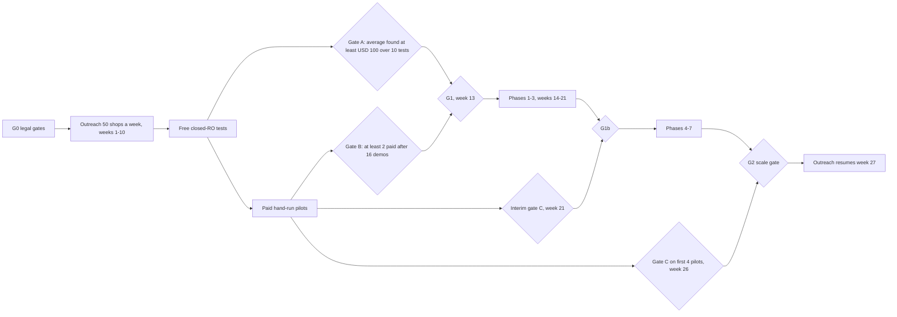

# Execution plan — SupplementPacket

Structure: phase → milestone → task → subtask. Nothing is built; every script and command is **proposed**. Labels: [Decision.md section 0](Decision.md#0-how-numbers-are-labelled). Requirements `MH-nn`: [PRD](PRD.md#6-must-haves). Risks `R-nn`: [verification-report-fixing.md](verification-report-fixing.md#5-production-risk-register). Tests: [section 7](#7-test-catalogue).

Owner roles: **Founder** (sales, hand-run delivery, operations), **Developer** (the founder or a second developer from the team of 1 to 3 [C]), **Shop** (owner, estimator or office manager at a pilot shop), **Counsel** (external; cost not budgeted, a missing input).

## 1. Sequence and gates

| Weeks | Work | Gate at the end |
|---|---|---|
| 0 | M0.1 legal gates, list, hand-test kit | **G0**, in parts: T-0.1.1 closed before the first call; T-0.1.2 and T-0.1.7 closed for a shop before its first real estimate is received; T-0.1.6 before the first visit; T-0.1.5 before the first invoice |
| 1-10 | M0.2 outreach to 500 shops; free tests | Gate A about week 7 |
| 4-26 | M0.3 hand-run pilots (each 30 days, measured to day 60 and day 90; a pilot paid in week 13 reaches day 90 in week 26) | Gate B week 13 and **G1**; interim gate C week 21 and **G1b**; full gate C week 26 |
| 14-21 | Phases 1 to 3 (released by G1) | Parser accuracy 95% [C] |
| 22-26 or later | Phases 4 to 7 (released by G1b) | Test catalogue green; **G2** = gate C passed and release checks done |
| 27 onward | Outreach resumes ([Decision 7.4](Decision.md#74-cash-required-during-the-acquisition-ramp)) | Monthly review against [Decision 12.9](Decision.md#129-gtm-stop-rule) |

No build task starts before G1, and no Phase 4 to 7 task before G1b. Up to 224 build hours are therefore spent before any collected-cash reading ([Decision FD-03](Decision.md#11-open-decisions-for-the-founder)). The paid pilot is delivered by hand in M0.3, so revenue and the answer to the decisive question do not wait for software.

## 2. External dependencies

| Dependency | Type | Blocks | Fallback |
|---|---|---|---|
| LQ-03: registration as a commercial telephone solicitor, or counsel's written view that exclusion (iv) applies | Legal | First call (T-0.1.1) | In-person presentation only, which needs LQ-05 and limits the pool to 357 shops |
| LQ-01: the shop's estimating-system licence clause, read and logged as permitting; LQ-02 for the publishers cited | Permission | Receipt of that shop's first real estimate, free test included (T-0.1.2); AI-1 | None for that shop: "not obtained" means blocked. The vendor's sanctioned sharing route if one exists |
| A closed RO from each prospect | Sample data | Free test | None; the prospect is disqualified |
| Signed agreement and USD 149 paid | Buyer decision, payment | Pilot day 1 | None |
| Baseline of 10 or more closed supplemented ROs | Sample data | PM-1 and the refund condition | PM-1 reported as not computable |
| Insurer response documents and remittances | Sample data | Approved and collected amounts | Packet counts as no response |
| 20 estimate pairs [C] | Sample data | Parser fixtures (T-1.1.2) | Fewer pairs with the accuracy claim narrowed |
| LQ-04 tax (T-0.1.5), LQ-05 border entry (T-0.1.6), LQ-06 privacy and data handling (T-0.1.7) | Legal | First invoice; first visit; first real estimate | No invoice, no visit, no real data until each is closed; demos by video |
| Cloud account and domain | Infrastructure | Phase 7 | Founder's VPS (FD-02) |

## 3. Phases, milestones and tasks

Estimates are founder or developer hours, low to high.

### Phase 0 — Validation and go-to-market (no application)

#### Milestone M0.1 — Legal gate, list and hand-test kit

Entry: founder decision FD-01. Dependencies: counsel and accountant (cost not budgeted). Owner: Founder. Outcome: 500 verified shop rows, a compliant script, and every legal question either answered in writing or blocking its step. Exit: the G0 parts for calling are recorded; list passes its checks; kit run once on a synthetic RO.

| ID | Need | Owner | Hours | Deliverable | Acceptance check | Subtasks |
|---|---|---|---|---|---|---|
| T-0.1.1 | LQ-03; [Decision 12.4](Decision.md#124-channel-sequence-and-weekly-volume) | Founder, Counsel | 6-10 | Registration with the Washington Department of Licensing, or counsel's written view that it is not required and LQ-05 answered yes; call script; email footer; written confirmation and cancellation notice | **No call before this is closed.** Script identifies caller, company, registration number and purpose in 30 seconds, states no price, refund or recovery figure, takes no payment, records nothing; email states the refund conditions; footer has postal address and opt-out; suppression list exists; fee recorded as a cost | Apply or obtain the written view; write script; write footer and confirmation; create do-not-contact sheet |
| T-0.1.2 | LQ-01, LQ-02; [Decision 3.1](Decision.md#31-rights-to-supporting-repair-material) | Founder, Counsel | 4-8 | Rights log: one row per shop and estimating system with the clause text and source; one row per OEM publisher cited | **No real estimate is received from a shop until its row says the clause was read and permits it, or counsel's written view is logged.** "Not obtained" keeps that shop blocked. A publisher with no row gets no citation beyond its public position statements | Ask each prospect for its licence pages before it sends anything; read OEM portal terms for the makes in the first tests; log |
| T-0.1.3 | Decision 12.3 prospect list | Founder | 16-18 | Sheet of 500 Washington locations, two cohorts of 250 | No duplicate phone or address; no multi-shop operators or dealers; every row has a source; qualified count recorded | Pull three sources; de-duplicate; tag county; split cohorts (drive range first) |
| T-0.1.4 | Hand-run delivery; [PRD section 9](PRD.md#9-highest-cost-user-mistake) | Founder | 8-12 | Difference sheet, packet template with a "DRAFT — NOT APPROVED" watermark, approval sheet listing every line with its amount and evidence file names, three-amount ledger with baseline counts, checklist v0 | One synthetic RO goes from two PDFs to a packet in under 2 hours; totals reconcile; the watermark is removed only on the copy generated after the sheet is signed; a change after signing forces a new sheet | Build sheets; write checklist from own knowledge only; dry run |
| T-0.1.5 | LQ-04 | Founder, Accountant | 3-5 | Written answer on Washington sales tax, B&O tax and nexus from visits | **No invoice before this is closed**; the invoice template shows tax treatment | Ask; record; set up registration if required |
| T-0.1.6 | LQ-05 | Founder, Counsel | 2-4 | Written answer on entering the US for sales visits | **No visit before this is closed**; until then demos are by video and the in-person fallback of LQ-03 is unavailable | Ask; record; carry the answer on trips |
| T-0.1.7 | LQ-06; hand-run data handling in [Decision section 5](Decision.md#5-offer-channel-and-pilot) | Founder, Counsel | 4-6 | Written answer on the privacy law that applies; per-shop access-controlled folder in a US region; handling rule in the agreement | **No real estimate before this is closed**: no email attachments, founder-only access, owner details never copied into sheets, deletion 90 days after the pilot ends, deletion logged | Ask; set up folders; write the clause; test the deletion |

#### Milestone M0.2 — Outreach and free closed-RO tests

Entry: G0. Dependencies: T-0.1.1, T-0.1.3, T-0.1.4. Owner: Founder. Outcome: 16 expected tests from 500 shops. Exit: Gate A evaluated in writing.

| ID | Need | Owner | Hours | Deliverable | Acceptance check | Subtasks |
|---|---|---|---|---|---|---|
| T-0.2.1 | Funnel, Decision section 8 | Founder | 60-70 | 50 new shops contacted each week for 10 weeks; touch log | Weekly log shows 50 first calls, follow-ups due, opt-outs honoured the same day | Call 2-4 pm Pacific; email only to given addresses; second call day 7 |
| T-0.2.2 | Discovery | Founder | 10-12 | Notes from about 40 conversations using the five discovery questions [C] | Each note records insurer-paid repairs per month, supplements per month, who writes them, estimating system, current tool, manual minutes per supplement, and whether supplements cost 5 or more hours a week (the brief's week-1 measure, kept as a measure, not a gate) | Ask; record; disqualify per Decision 12.1 |
| T-0.2.3 | Free test offer [C] | Founder, Shop | 80-90 | About 16 hand-run tests with a difference list and sample packet; result presented by video, or in person on up to 4 day-trips once T-0.1.6 is closed | Returned in 2 business days; each records requested, approved and collected on that closed RO and the supportable missed amount with its basis | Receive PDFs; compare; draft packet; present; ask for the pilot |
| T-0.2.4 | Gate A | Founder | 2-3 | One-page result after test 10 | Average supportable missed amount per RO computed from the 10 sheets; stop or continue written down | Compute; record the distribution, not only the mean |

#### Milestone M0.3 — Paid pilots delivered by hand and decided

Entry: a shop accepts after its free test. Dependencies: payment, baseline, T-0.1.4. Owner: Founder. Outcome: 4 expected paid pilots measured. Exit: G1 decision at week 13; Gate C result per pilot at day 90.

| ID | Need | Owner | Hours | Deliverable | Acceptance check | Subtasks |
|---|---|---|---|---|---|---|
| T-0.3.1 | [Decision 5.1](Decision.md#51-refund-criterion) | Founder, Shop | 4-6 | One-page agreement signed by the owner; written confirmation with the cancellation notice; USD 149 invoice paid before day 1 by card, bank transfer or cheque | Agreement states window, data supplied, the incremental refund test with all three conditions and the incomplete-baseline rule, confidentiality, data handling, and that the vendor never contacts insurers; T-0.1.5 closed | Draft; send; collect payment; record start date |
| T-0.3.2 | PM-1, PM-4 baseline | Founder, Shop | 8-10 | Count of insurer-paid ROs closed in the three baseline months and the count of those with a supplement; 10 or more supplemented baseline ROs with three amounts, dates where known and a source note; entry date of each row | Rows with a missing amount are kept and marked incomplete, not filled in; without the count the increment is reported as not computable | Request list and count; enter; confirm with the office manager |
| T-0.3.3 | Pilot delivery by hand | Founder, Shop | 60-72 | Watermarked draft packets within 1 business day (late drafts logged, they count toward refund condition (b)); signed approval sheet per packet; ledger updated weekly | No packet leaves without every line and its evidence initialled by the estimator on the final version; the founder sends nothing to any insurer; files move only through the shop's folder | Receive; compare; draft; estimator approves and sends; log sent date and channel |
| T-0.3.4 | PM-1, PM-2, PM-4 | Founder, Shop | 6-8 | Day-60 and day-90 report per shop with incremental approved and incremental collected; refund paid where due | Every approved dollar traces to an insurer document and every collected dollar to a remittance and a packet; the window RO count has a source; refund paid within 10 business days | Collect documents and counts; compute; review with the owner; ask for "continue" |
| T-0.3.5 | Decision section 9 | Founder | 2-3 | Written G1 decision (week 13), G1b (week 21), gate C result (week 26) | Each decision cites gate values, sample sizes and which funnel case applied | Record; update Decision.md if the offer changes |

Phase 0 total: 275 to 337 hours. Of the low figure, 230.7 hours are the two cohorts in [Decision 12.4](Decision.md#124-channel-sequence-and-weekly-volume) (2 × 115.3); the rest is one-off setup and measurement.

### Phase 1 — Specification and design

#### Milestone M1.1 — Specification frozen against pilot findings

Entry: G1 passed. Dependencies: pilot notes, estimate pairs. Owner: Developer. Outcome: fixtures and tested prototypes. Exit: documents updated; fixture set complete.

| ID | Need | Owner | Hours | Deliverable | Acceptance check | Subtasks |
|---|---|---|---|---|---|---|
| T-1.1.1 | All MH | Developer | 6-10 | PRD, App-flow and schema revised from hand-run findings | Every change listed in the verification file | Review ledger and notes; edit; rerun the document check |
| T-1.1.2 | MH-02, WQ-1 | Developer | 16-24 | 20 estimate pairs transcribed by hand; synthetic derivatives for the repository | Real PDFs stay outside the repository; synthetic files contain no real names, VINs or claim numbers | Transcribe; build synthetic generator; verify totals |
| T-1.1.3 | MH-03, MH-06 | Developer, Shop | 8-12 | Clickable prototype of S-06 and S-08 tried by 2 estimators | Each finds the source line and approves 5 lines unaided | Build; observe; record changes |
| T-1.1.4 | Decision 3.1 | Founder | 2-4 | Recorded decisions on LQ-01 and LQ-02 | AI-1, AI-2 and citations per publisher each marked allowed or off | Update rights log; set defaults |

### Phase 2 — Foundation

#### Milestone M2.1 — Repository and environment

Entry: M1.1. Dependencies: none external. Owner: Developer. Outcome: one command starts everything. Exit: E2E-09 and IT-13 pass.

| ID | Need | Owner | Hours | Deliverable | Acceptance check | Subtasks |
|---|---|---|---|---|---|---|
| T-2.1.1 | R-03, R-04, R-06 | Developer | 6-8 | Repository layout of [TRD section 5](TRD.md#5-building-block-view); import-boundary check | Check fails on an app-to-app import or a duplicated helper name | Skeleton; boundary script; shared settings module |
| T-2.1.2 | R-17 | Developer | 4-6 | `make dev` with health checks | All services healthy within 90 seconds from a clean clone | Compose file; health endpoints; seed data |
| T-2.1.3 | R-08, R-10 | Developer | 6-8 | CI: tests, migration-head check, ORM parity | A second migration head or a missing index fails the build | Workflow; parity script; head check |
| T-2.1.4 | R-07, R-12 | Developer | 4-6 | `packages/obs` logging with correlation and redaction | IT-11 and IT-13 pass | Logger; filter; propagate through jobs |

#### Milestone M2.2 — Schema, tenancy and identity

Entry: M2.1. Dependencies: FD-02 hosting choice for the storage provider. Owner: Developer. Outcome: isolated tenants with roles. Exit: IT-01, IT-02, IT-16 pass.

| ID | Need | Owner | Hours | Deliverable | Acceptance check | Subtasks |
|---|---|---|---|---|---|---|
| T-2.2.1 | MH-10, R-05, R-09, R-11 | Developer | 12-16 | Migrations for [schema.md](schema.md#3-data-dictionary) with row-level security | IT-01 passes with the tenant setting unset and set | Tables; policies; composite keys; concurrent-index convention |
| T-2.2.2 | MH-10 | Developer | 12-18 | Password, TOTP, sessions, invites, reset (S-01, S-02) | Reset does not bypass TOTP; lockout as specified | Hashing; TOTP; cookies; rate limits |
| T-2.2.3 | MH-10 | Developer | 8-12 | Permission table, Operator grants, vendor provisioning of tenant, location, Owner invitation and pilot | IT-02 passes for every role and endpoint; IT-20 passes | Policy map; grant expiry; 404 versus 403 rules; provisioning endpoints |
| T-2.2.4 | MH-10 | Developer | 4-6 | Append-only audit events | IT-16 passes | Trigger; writer helper |
| T-2.2.5 | R-13, R-14, R-16 | Developer | 6-8 | Key builder, signed URLs, temporary-upload lifecycle | UT-14, IT-12 pass | Key module; lifecycle rule; base-URL check |

### Phase 3 — Ingestion

#### Milestone M3.1 — Estimates in, lines out

Entry: M2.2. Dependencies: fixtures. Owner: Developer. Outcome: reconciled lines from CCC ONE PDFs. Exit: WQ-1 at least 95% on the fixture set; IT-03, IT-04 pass.

| ID | Need | Owner | Hours | Deliverable | Acceptance check | Subtasks |
|---|---|---|---|---|---|---|
| T-3.1.1 | MH-01 | Developer | 6-8 | Upload endpoint with validation and versions | Duplicate file returns the existing version | Content check; hash; idempotency key |
| T-3.1.2 | MH-12, R-01, R-02 | Developer | 8-12 | Job table, worker loop, sweeper | UT-13, IT-03, IT-04 pass | Claim; compare-and-set; retry; retry endpoint |
| T-3.1.3 | MH-02 | Developer | 24-36 | CCC ONE parser with totals reconciliation | UT-02, UT-03 pass; 95% line accuracy | Layout rules; totals; owner-detail discard; version tag |
| T-3.1.4 | MH-01, MH-02 | Developer | 14-20 | S-04 and S-05 with manual entry | E2E-02 passes | Upload UI; split view; edit; confirm totals |
| T-3.1.5 | AI-1 (only if T-1.1.4 allows) | Developer | 6-10 | Gated extraction assist with fixtures | UT-15 passes; off by default | Adapter; schema validation; consent switch |

### Phase 4 — Lines, evidence, approval, packet

#### Milestone M4.1 — Differences and checklist

Entry: M3.1. Dependencies: checklist v0 from T-0.1.4. Owner: Developer. Outcome: reproducible difference list. Exit: UT-04 to UT-06 pass.

| ID | Need | Owner | Hours | Deliverable | Acceptance check | Subtasks |
|---|---|---|---|---|---|---|
| T-4.1.1 | MH-03 | Developer | 16-24 | Deterministic diff engine with versions | UT-04, UT-05, UT-06 pass | Normalisation; pairing; categories; needs-review rule |
| T-4.1.2 | MH-04 | Developer | 6-8 | Checklist v1 with versioning | Items carry no labour time or guide text; origin recorded | Import from T-0.1.4; version table |
| T-4.1.3 | MH-03, MH-06 | Developer | 14-20 | S-06 lines workspace | Lines are approved one at a time; Exclude selected lists each line; no batch approval exists | Table; filters; exclude-selected dialog; conflict handling |

#### Milestone M4.2 — Evidence, approval and packet

Entry: M4.1. Dependencies: T-1.1.4 decisions on LQ-01 and LQ-02. Owner: Developer. Outcome: frozen, hashed packets the estimator sends. Exit: IT-05, IT-06, IT-15, E2E-01 pass.

| ID | Need | Owner | Hours | Deliverable | Acceptance check | Subtasks |
|---|---|---|---|---|---|---|
| T-4.2.1 | MH-05, R-19 | Developer | 12-16 | S-07: photos with attestation, typed references with the URL rule | IT-05, IT-15 pass; metadata removed; evidence changes reset approval | Bulk upload; re-encode; reference form; attestation; notices |
| T-4.2.2 | MH-06 | Developer | 12-18 | Approval, reset on any line, evidence or source change, review fingerprint, freeze with snapshot | UT-07, UT-08, IT-06, IT-18 pass | Status rules; reset function and triggers; fingerprint; locking; snapshot |
| T-4.2.3 | MH-07 | Developer | 12-18 | Packet PDF and generated email draft (S-08, S-09) | PDF holds only approved lines; hash stable across re-render; UT-19 passes | Template with escaped text; render job; draft watermark; email rule |
| T-4.2.4 | MH-07 | Developer | 6-8 | Mark sent, undo, supersede | E2E-06 passes; no code path contacts an insurer | Endpoints; correction note; ledger effect |

### Phase 5 — Ledger and reports

#### Milestone M5.1 — Three amounts, report and remaining screens

Entry: M4.2. Dependencies: hand-run ledgers from T-0.3.3 as comparison data. Owner: Developer. Outcome: the pilot metrics computed in the product. Exit: UT-09 to UT-12, E2E-07, E2E-08 pass.

| ID | Need | Owner | Hours | Deliverable | Acceptance check | Subtasks |
|---|---|---|---|---|---|---|
| T-5.1.1 | MH-08 | Developer | 14-20 | S-10 responses and payments with packet attribution and remittance documents | UT-09, UT-10, UT-17, UT-18 pass | Response rules; carry-forward on supersede; payments; proposed split; reversal; duplicate warning |
| T-5.1.2 | MH-08 | Developer | 6-10 | S-11 tracker and CSV | Ratios hidden under 5 packets | Queries; chart with table |
| T-5.1.3 | MH-09 | Developer | 10-14 | S-12 baseline, counts and pilot report | UT-11, UT-12, E2E-07 pass against the hand-run ledgers | Baseline entry; counts; refund test; PM-1, PM-2, PM-4 |
| T-5.1.4 | MH-11, R-14 | Developer | 14-20 | S-13, S-14: retention sweep, export, takedown, deletion | IT-10, IT-19 pass | Sweep job; export job; takedown job; deletion job |
| T-5.1.5 | R-18, R-20 | Developer | 6-10 | S-03, shell, navigation and label audit | E2E-03, E2E-08 pass | Step bar; link crawl; wording review with an estimator |

### Phase 6 — Verification

#### Milestone M6.1 — Test hardening

Entry: M5.1. Dependencies: an estimator for the wording and keyboard review. Owner: Developer. Outcome: the catalogue in section 7 passes. Exit: no failing test; gaps listed.

| ID | Need | Owner | Hours | Deliverable | Acceptance check | Subtasks |
|---|---|---|---|---|---|---|
| T-6.1.1 | R-05 | Developer | 8-12 | Permission and concurrency suites complete | IT-01, IT-02, IT-06 cover every endpoint | Endpoint inventory test; race tests |
| T-6.1.2 | R-09, R-10, R-11 | Developer | 4-6 | Migration and backfill rehearsal | IT-07, IT-08, IT-09 pass | Kill mid-backfill; two-head branch; concurrent index |
| T-6.1.3 | [design section 8](design.md#8-accessibility-map) | Developer | 6-8 | Manual accessibility checks recorded | Every row has a result; failures filed | Keyboard pass; screen-reader pass; zoom |
| T-6.1.4 | [TRD 11.3](TRD.md#113-threat-model) | Developer | 4-6 | Control-by-control review | Each planned control has a test or is marked not met | Walk the table |
| T-6.1.5 | TRD section 10 | Developer | 4-6 | Load script results | Targets met or revised with reasons | Run; record |

### Phase 7 — Release and software pilot

#### Milestone M7.1 — Release and operations

Entry: M6.1. Dependencies: cloud account. Owner: Founder. Outcome: production with tested recovery. Exit: restore drill and rollback rehearsal recorded.

| ID | Need | Owner | Hours | Deliverable | Acceptance check | Subtasks |
|---|---|---|---|---|---|---|
| T-7.1.1 | R-15, TRD section 7 | Founder | 8-12 | Production environment; backup; restore drill | IT-14, IT-17 pass in a production-like copy within 4 hours | Provision; restore to a new instance; verify hashes |
| T-7.1.2 | FM-5, R-12 | Founder | 4-6 | Alerts for queue age, job failures, error rate, storage errors | A forced stuck job alerts within 15 minutes | Metrics; alert routes |
| T-7.1.3 | TRD section 7 | Founder | 2-4 | Rollback rehearsal | Previous image runs on the new schema | Deploy; roll back; record |
| T-7.1.4 | MH-11 | Founder | 2-4 | Retention and deletion verified on synthetic tenant | Objects and rows gone; deletion replay works after restore | Run; inspect |

#### Milestone M7.2 — Software pilot and scale decision

Entry: M7.1, Gate C results. Dependencies: each pilot shop's consent to move onto the application. Owner: Founder. Outcome: hand-run shops on the application; G2. Exit: G2 written.

| ID | Need | Owner | Hours | Deliverable | Acceptance check | Subtasks |
|---|---|---|---|---|---|---|
| T-7.2.1 | All MH | Founder, Shop | 6-8 | Hand-run shops onboarded; ledgers imported | Imported totals equal the spreadsheet totals to the cent | Create tenants; import; walk through with each estimator |
| T-7.2.2 | Decision section 9 | Founder | 2-3 | G2 decision; cohort 3 scheduled | Decision cites Gate C values | Record; schedule outreach |
| T-7.2.3 | R-21, R-22 | Founder | 2-3 | Scope and branch review | No merged work without an MH or task ID; no stale branches | List branches; compare features with PRD |

## 4. Parallel work and critical path

- **Critical path:** T-0.1.1 → T-0.2.1 → T-0.2.3 → T-0.3.1 → T-0.3.3 → G1 → T-1.1.2 → T-2.2.1 → T-3.1.2 → T-3.1.3 → T-4.1.1 → T-4.2.2 → T-4.2.3 → T-5.1.1 → T-5.1.3 → T-7.1.1 → T-7.2.1.
- **Parallel:** T-0.1.2 with T-0.1.3; T-0.3.3 with T-0.2.1 (cohort 2); T-2.2.2 with T-2.2.5; T-3.1.4 with T-3.1.3 once the line model exists; T-4.2.1 with T-4.1.3; T-5.1.2 and T-5.1.4 with T-5.1.3; T-7.1.2 with T-7.1.1.
- **Waiting on others:** payment (T-0.3.1), sample data (T-0.2.3, T-0.3.2, T-1.1.2), permissions (T-0.1.2, T-1.1.4), buyer decision ("continue" in T-0.3.4).

## 5. Estimate summary

| Phase | Low | High |
|---|---|---|
| 0 Validation and go-to-market | 275 | 337 |
| 1 Specification and design | 32 | 50 |
| 2 Foundation | 62 | 88 |
| 3 Ingestion | 58 | 86 |
| 4 Lines to packet | 78 | 112 |
| 5 Ledger and reports | 50 | 74 |
| 6 Verification | 26 | 38 |
| 7 Release and software pilot | 26 | 40 |
| **Build, phases 1 to 7** | **332** | **488** |
| of which Phases 1 to 3 (before G1b) | 152 | 224 |

The chat's build figure is 160 hours, 20 days [C], for "two estimate PDFs → difference list → supplement request PDF". The author's sum is 2.1 to 3.1 times that because it adds tenancy, identity, the ledger, the pilot report, tests and release. It rose from 324 to 476 hours in review round 1 (approval fingerprint, payment evidence, takedown, provisioning). This is a departure, not a correction of the chat. At the chat's CAD 100 an hour it is CAD 33,200 to 48,800, USD 24,057.97 to 35,362.32 at 1.38 ([Decision 7.1](Decision.md#71-cost-categories)). **Capacity:** during weeks 14 to 26 the founder has about 26 hours a week for building (40 minus 14 serving 4 hand-run shops), which is 338 hours. The low estimate fits only with no idle time at G1b (12.8 weeks); the midpoint of 410 hours needs about 72 hours from a second developer or moves the week-27 restart to about week 30. The week-27 restart used in the ramp is therefore the optimistic end.

## 6. Proposed scripts and commands

| Proposed command | Purpose | Inputs | Outputs | Failure behaviour |
|---|---|---|---|---|
| `make dev` | Start database, storage, api, worker, web, mail catcher (B1: exists for database, api and worker; see [AGENTS section 11](AGENTS.md#11-utilities-index-b1)) | None | Health summary | Exits non-zero naming the unhealthy service |
| `make test` (exists, B1) | Unit and integration tests; drops and re-migrates the test database first | Test database | Report | Non-zero on any failure |
| `scripts/check_boundaries.py` (exists, B1) | Enforce import rules | Source tree | List of violations | Non-zero if any |
| `scripts/check_migration_heads.py` (exists, B1) | One linear migration history | Migrations folder | Head count | Non-zero if more than one |
| `scripts/orm_parity.py` (exists, B1) | Compare migrated schema with ORM metadata | Migrated test database (B1; two scratch databases are not allowed on the build machine) | Diff | Non-zero on any difference |
| `scripts/seed_synthetic.py` (exists, B1: tenants, users, pilot, a synthetic checklist; no ROs or PDFs; B2: sign-in credentials instead of sessions) | Two synthetic tenants with ROs and PDFs | Seed number | Rows and files | Idempotent; safe to rerun |
| `scripts/run_backfill.py NAME` | Batched, resumable backfill | Backfill name | Progress row | Stops on error; rerun continues |
| `scripts/restore_drill.sh` | Restore to a new instance and verify | Restore time | Row counts, hash check | Non-zero on mismatch; never touches production |
| `scripts/replay_deletions.py` | Reapply deletions after a restore | Restore time | Purged tenants and objects | Resumable |
| `scripts/load_parse.py` | Load test for TRD section 10 | Synthetic PDFs, concurrency | Latency percentiles | Reports, does not gate |
| `scripts/link_crawl.py` | Find broken internal links and unlabelled controls | Base URL, test login | List | Non-zero if any |

## 7. Test catalogue

Fixtures are synthetic. The result of every test is recorded only in [verification-report-fixing.md section 9](verification-report-fixing.md#9-build-milestone-b1-2026-11-11); tests not listed there are **Not run**.

### 7.1 Unit tests

| ID | Fixture | Action | Expected |
|---|---|---|---|
| UT-01 | Strings "1,284.50", "0.1", "-3.00" | Parse to cents and format | 128450, 10, -300; round trip exact |
| UT-02 | Lines summing to 421210 with printed total 426210 | Reconcile | `unreconciled`, difference 5000 |
| UT-03 | Synthetic CCC ONE PDF, 42 lines, 3 pages | Parse | 42 lines with page and line numbers; owner name and address absent from output |
| UT-04 | Shop line "Blend fender 1.2 h refinish"; insurer has none | Diff | One `missing_operation` line, requested equals 1.2 × refinish rate in cents |
| UT-05 | Random pairs of estimates | Diff 100 times | Identical output each time |
| UT-06 | One ambiguous free-text line among 30 | Diff | That line `needs_review`; the other 29 compared; totals exclude it |
| UT-07 | Approved line with one photo and one reference | In turn: change amount; add a photo; delete the photo; edit the reference; change the attestation; correct the linked shop estimate line; re-run the comparison with a changed source | After each: status `draft`, approver cleared, `row_version` incremented, audit event; an unrelated approved line is untouched |
| UT-08 | RO with one draft and one needs-review line | Freeze | Refused listing both |
| UT-09 | Requested 15000 | Record approved 16000 without reason; then `denied` | First refused; second sets approved 0 |
| UT-10 | Two packets, one superseded, payments of 40000 and −5000 reversal | Compute ledger | Requested from the live packet only; collected 35000; three separate fields |
| UT-11 | Pilot: 9 qualifying packets (one drafted late by the vendor and not sent, counted), approved 180000 at day 60, 6 with response documents; baseline 30 declared supplemented ROs, all complete, with approved total 450000 over 150 insurer-paid ROs; window count 40 | Refund test | Baseline rate 3000 per RO; expected 120000; incremental approved 60000, under 100000; conditions (a) and (b) met, (c) not met (67%); no refund due. With 8 documents (89%), refund due. Variants (baseline rule: lead ruling B1-004, pending owner confirmation; the 80% threshold no longer has an effect): 24 of the 30 rows complete totalling 360000 gives max(15000 × 30, 360000 + 6 × 15000) = 450000 and the same result; 20 complete totalling 300000 with a highest row of 40000 gives max(450000, 300000 + 10 × 40000) = 700000, rate 4667, expected 186667, incremental negative, flagged as resolved in the shop's favour; an incomplete row with a supplied amount above the highest complete row counts at its own amount. Without the counts-supplied time or the vendor-late record, the affected condition and the result are "undetermined". The late-draft variant also runs through the API (B1-003); a late draft counts once per repair order and not in addition to that repair order's sent packet |
| UT-12 | 9 complete baseline rows; or 12 rows but no window count | Compute PM-1 and PM-4 | "Not computable" naming the missing item; PM-2 still computed; a baseline row without dates sets the uncensored flag |
| UT-13 | Job at `state_version` 3 | Apply a completion carrying version 2 | Discarded; state unchanged; logged |
| UT-14 | Two tenants, same file | Build keys | Different prefixes; no user file name in the key |
| UT-15 | Wording suggestion containing a document number not in the input | Validate | Rejected; template sentence used |
| UT-16 | Sent on a Friday | Age in business days the next Wednesday | 3 |
| UT-17 | Packet 1 sent, line A approved 15000, line B denied; packet 2 supersedes it repeating A unchanged and amending B; payment of 15000 on packet 1 | Compute ledger | Approved 15000 once, carried to packet 2; packet 1 contributes nothing; the payment is attributed to packet 2 |
| UT-18 | Packet approved 20000; supplement payment 20000 with a remittance document; second payment 5000 without one and without a reason | Record and compute | Second payment refused until a reason is given; then collected (evidenced) 20000 and "recorded, not evidenced" 5000; pilot report uses 20000; a supplement payment with no packet is refused |
| UT-19 | Frozen-candidate email draft for a packet totalling 128450 | Insert "USD 1,500" in the free paragraph; then edit wording only | First refused naming the amount; second accepted and the review fingerprint changes |

### 7.2 Integration tests

| ID | Fixture | Action | Expected |
|---|---|---|---|
| IT-01 | Tenants A and B | Call every endpoint as A with B's identifiers; run worker with A's job naming B's file | 404 everywhere; worker refuses; no rows or objects read |
| IT-02 | Office and Operator sessions | Approve, exclude, freeze, mark sent | 403; audit event; no state change |
| IT-03 | Upload with the client aborting after 1 second | Repeat with the same key | One document, one job; job completes; state visible |
| IT-04 | Running job | Deliver "succeeded" then a late "running", then a duplicate "succeeded" | Final state `succeeded`; one set of lines |
| IT-05 | 9 photos, 2 invalid | Bulk upload, then retry | 7 attached, 2 reported; retry attaches none twice |
| IT-06 | Approved line | Edit as Operator while Estimator freezes | 409 naming the line; no packet |
| IT-07 | Branch with a second migration head; model with an index missing in migrations | CI | Both fail |
| IT-08 | Backfill of 2,000 rows | Kill at row 900; rerun | Completes; no row processed twice |
| IT-09 | Table with 100,000 rows under writes | Add index | Writes continue; index valid |
| IT-10 | Closed RO past retention; abandoned temporary upload | Run sweep twice | Objects gone; rows marked purged; second run does nothing |
| IT-11 | Parse job with retry | Read logs | One correlation ID across request, job and retry; no VIN, claim number, name or amount |
| IT-12 | Proxy with a public host | Request a packet URL | Host equals `PUBLIC_BASE_URL`; never an internal name |
| IT-13 | Worker image without web dependencies | Start | Healthy; logs emitted |
| IT-14 | Tenant deleted after a backup | Restore, replay deletions | Tenant absent before the application reopens |
| IT-15 | Estimator session | Add a subscription-portal procedure reference with a URL; upload photos without the attestation tick; look for any endpoint accepting a procedure document | URL refused, citation accepted without it; upload refused; no such endpoint in the route inventory. (This tests the stated controls only; it does not show that licensed content cannot be uploaded as a photo) |
| IT-16 | Audit rows | Update and delete as the application role | Both rejected |
| IT-17 | Running stack with data | Recreate every container | All rows and objects still present |
| IT-18 | Line approved by the Estimator; review screen open | Operator replaces the line's photo, or edits the email draft, then the Estimator submits the freeze with the old fingerprint | 409 listing the change; no packet; the line is `draft`; after re-approval and a fresh review the freeze succeeds |
| IT-19 | Sent packet with a photo later found to be a procedure screenshot | Owner takedown | PDF and evidence objects gone; snapshot text redacted; amounts, hash and audit rows intact; ledger totals unchanged |
| IT-20 | Owner, Estimator and Operator sessions | Create a tenant and a pilot | Refused for Owner and Estimator; succeeds for the Operator; the Operator still cannot read the tenant's ROs without a grant |

### 7.3 End-to-end tests

| ID | Fixture | Action | Expected |
|---|---|---|---|
| E2E-01 | Synthetic pair | Upload, review, diff, checklist item, photo, approve, freeze, download, mark sent, record response, record payment | Three totals correct; PDF has only approved lines |
| E2E-02 | PDF with an unreadable page | Upload | Failure shown; manual entry completes the RO |
| E2E-03 | RO at each step | Refresh, Back, Forward, open deep link in a new session | Same state each time; frozen packet never editable |
| E2E-04 | Review screen | Double-click Freeze, Mark as sent, Add payment | One record each |
| E2E-05 | S-06 to S-10 | Complete with keyboard only; run automated accessibility scan | Task completes; no serious automated findings |
| E2E-06 | Sent packet | Supersede with one line withdrawn by excluding it from the new version | New version; old readable; the withdrawn line is outside the new requested total, email request and PDF request, listed as withdrawn; ledger shows the withdrawn amount |
| E2E-07 | Imported hand-run pilot ledger | Open pilot report at day 60 and day 90 | Figures equal the spreadsheet to the cent |
| E2E-08 | Whole application | Crawl links and controls | No broken link, no unlabelled control |
| E2E-09 | Clean clone | `make dev` | Healthy within 90 seconds |

## 8. Monitoring, rollback and restore in the plan

| Operational need | Task | Evidence expected |
|---|---|---|
| Queue age, job failure, error-rate and storage alerts | T-7.1.2 | Forced-failure alert record |
| Rollback | T-7.1.3 | Rehearsal note with timings |
| Backup and restore | T-7.1.1 | Drill note: restore time, counts, hash check |
| Retention and deletion | T-5.1.4, T-7.1.4 | Sweep and deletion logs on a synthetic tenant |
| Incident handling | T-7.1.2 | One tabletop exercise on a cross-tenant report |
