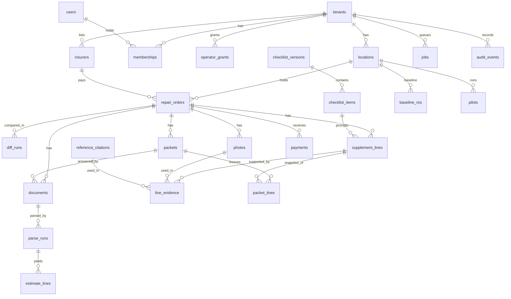

# Schema — SupplementPacket

Proposed PostgreSQL 16 schema. Build milestone B1 implements every table below except `invites`, `ai_calls`, `exports` and `deletion_requests`, in migration `20261111_0001` (`packages/db`); the fields B1 added are marked *(B1)*. Requirements: [PRD section 6](PRD.md#6-must-haves). Decisions `AD-nn`: [TRD section 9](TRD.md#9-architecture-decisions). Risks `R-nn`: [verification-report-fixing.md section 5](verification-report-fixing.md#5-production-risk-register).

## 1. Conventions

- Primary keys are `uuid` (generated by the database) unless stated. Timestamps are `timestamptz` in UTC; dates the user types (`sent_on`, `paid_on`, `response_date`) are `date` in the tenant's time zone.
- Money is `bigint` cents (AD-08). Hours are `numeric(6,2)`.
- Every tenant-owned table has `tenant_id uuid not null` referencing `tenants`, is covered by a row-level security policy `tenant_id = current_setting('app.tenant_id')::uuid`, and repeats `tenant_id` in every foreign key (composite keys) so a child can never point at another tenant's parent.
- `row_version int not null default 1` on user-edited rows; updates must match it.
- "Null" below means the value is genuinely not known or not applicable; the application never requires a user to fill a field they do not have.

## 2. Entity-relationship diagram

## 3. Data dictionary

Format: field, type, nullability, default, constraint or note. `FK` = foreign key including `tenant_id`.

### Identity and tenancy

| Table | Fields |
|---|---|
| `tenants` | `id`; `name text not null`; `status text not null default 'active'` check in (`active`,`read_only`,`deleting`); `timezone text not null default 'America/Los_Angeles'`; `retention_days int not null default 90` check 30 to 730; `ai_consent_at timestamptz null`; `ai_consent_by uuid null`; `created_at` |
| `locations` | `id`; `tenant_id`; `name text not null`; `city text null`; `state char(2) not null default 'WA'`; unique (`tenant_id`, `name`) |
| `users` (global, no `tenant_id`) | `id`; `email citext not null unique`; `password_hash text not null`; `totp_secret_enc bytea null`; `totp_enabled_at timestamptz null`; `display_name text null` *(B1 fix round 1: the approver's name on the packet PDF)*; `is_operator boolean not null default false`; `status text not null default 'active'`; `created_at` |
| `memberships` | `id`; `tenant_id`; `user_id FK users`; `role text not null` check in (`owner`,`estimator`,`office`); unique (`tenant_id`, `user_id`); *(B1 fix round 1) a trigger resets every line a user approved when that user's Owner or Estimator membership is changed to another role or removed; freeze also refuses (and resets) approvals whose approver is no longer an active Owner or Estimator*; at least one `owner` per tenant enforced in the service layer inside the transaction |
| `operator_grants` | `id`; `tenant_id`; `operator_user_id FK users`; `granted_by FK users`; `created_at` *(B1)*; `expires_at timestamptz not null` (at most 30 days ahead, check against `created_at`); `revoked_at null` |
| `invites` | `id`; `tenant_id`; `email citext not null`; `role text not null`; `token_hash bytea not null unique`; `expires_at not null` (72 hours); `accepted_at null` |
| `sessions` (global) | `id bytea` (hash of the token); `user_id`; `tenant_id null`; `created_at`; `last_seen_at`; `expires_at`; `revoked_at null` |

### Repair orders and source documents

| Table | Fields |
|---|---|
| `insurers` | `id`; `tenant_id`; `name text not null`; unique (`tenant_id`, `lower(name)`) |
| `repair_orders` | `id`; `tenant_id`; `location_id FK`; `ro_number text not null`; `insurer_id FK null`; `claim_number text null`; `adjuster_name text null`; `adjuster_email citext null`; `vin text null` check length 17 when present; `vehicle_desc text null`; `email_free_paragraph text null` *(B1: the Estimator's one free paragraph of the email draft; part of the review fingerprint)*; `status text not null default 'open'` check in (`open`,`closed`); `closed_at null`; `row_version`; `created_by`; `created_at`; unique (`tenant_id`, `location_id`, `ro_number`) |
| `documents` | `id`; `tenant_id`; `ro_id FK`; `packet_id FK null` (required when `purpose` is `response` or `remittance`); `purpose text not null` check in (`insurer_estimate`,`shop_estimate`,`response`,`remittance`); `version int not null`; `source_system text not null default 'unknown'` check in (`ccc_one`,`mitchell`,`audatex`,`unknown`); `content_type text not null` *(B1: sniffed from content)*; `storage_key text null` (null after retention deletion); `sha256 bytea not null`; `size_bytes int not null` check at most 26214400; `page_count int null`; `uploaded_by`; `uploaded_at`; `purged_at null`; unique (`tenant_id`,`ro_id`,`purpose`,`version`); unique (`tenant_id`,`ro_id`,`purpose`,`sha256`) so a repeated upload returns the existing row |
| `parse_runs` | `id`; `tenant_id`; `document_id FK`; `parser_name text not null`; `parser_version text not null`; `status text not null` check in (`reconciled`,`unreconciled`,`failed`,`manual`); `printed_total_cents bigint null`; `parsed_total_cents bigint null`; `confirm_reason text null`; `confirmed_by null`; `is_current boolean not null default true`; `created_at`; partial unique index on (`document_id`) where `is_current` |
| `estimate_lines` | `id`; `tenant_id`; `parse_run_id FK`; `line_no int not null`; `page int null`; `section text null`; `operation text not null` check in (`replace`,`repair`,`remove_install`,`refinish`,`blend`,`sublet`,`scan`,`calibrate`,`materials`,`other`); `description text not null`; `part_number text null`; `part_type text null` check in (`oem`,`aftermarket`,`recycled`,`remanufactured`); `part_price_cents bigint null`; `labor_hours numeric(6,2) null`; `labor_type text null`; `labor_rate_cents bigint null`; `line_total_cents bigint not null`; `source text not null default 'parser'` check in (`parser`,`manual`,`ai_suggested`); `edited_by null`; `row_version`; unique (`parse_run_id`,`line_no`) |

### Lines, evidence and checklist

| Table | Fields |
|---|---|
| `diff_runs` | `id`; `tenant_id`; `ro_id FK`; `insurer_document_id FK`; `shop_document_id FK`; `engine_version text not null`; `created_by`; `created_at`; unique (`tenant_id`,`insurer_document_id`,`shop_document_id`,`engine_version`) |
| `supplement_lines` | `id`; `tenant_id`; `ro_id FK`; `diff_run_id FK null`; `diff_key text null` *(B1: stable key of a diff output across document versions; partial unique (`tenant_id`,`ro_id`,`diff_key`))*; `origin text not null` check in (`diff`,`checklist`,`manual`,`ai_suggested`); `category text not null` check in (`missing_operation`,`labor_hours_gap`,`refinish_hours_gap`,`part_price_gap`,`part_type_difference`,`rate_difference`,`materials_gap`,`other`); `shop_line_id FK null`; `insurer_line_id FK null`; `checklist_item_id FK null`; `match_state text not null default 'matched'` check in (`matched`,`needs_review`,`not_applicable`); `description text not null`; `requested_cents bigint not null` check at least 0; `hours_delta numeric(6,2) null`; `explanation text null`; `status text not null default 'draft'` check in (`draft`,`approved`,`excluded`); `approved_by null`; `approved_at null`; `approved_row_version int null`; `approved_fingerprint bytea null` (SHA-256 over amount, description, explanation and the sorted content hashes of its evidence at approval); `row_version`; `created_by`; `created_at`. Checks: `status='approved'` requires `approved_by`, `approved_at`, `approved_row_version = row_version`, `approved_fingerprint` and `match_state <> 'needs_review'`; `origin='checklist'` requires `checklist_item_id`; `origin='diff'` requires `diff_run_id` *(B1)*. A line is always inserted as `draft` (trigger, B1). Approving requires the actor role Owner or Estimator and `approved_by` equal to the acting user (trigger, B1). **Approval reset rule:** one service function, backed by triggers on `line_evidence`, `photos`, `reference_citations` and `estimate_lines`, increments `row_version` and sets `status='draft'` on every affected line when evidence is added, removed or edited, an attestation changes, a linked source line is corrected, or a new diff run changes the line; a line a new diff run no longer produces becomes `draft` with `match_state='needs_review'`. *B1: the function is `sp_reset_line`; any `row_version` increase clears approval and exclusion and writes an `line.approval_reset` audit event when the line was approved; a diff re-run recomputes every line and changes (and so resets) only lines whose computed values differ* |
| `checklist_versions` (global, read-only to tenants) | `id`; `version int not null unique`; `published_at`; `author text not null` |
| `checklist_items` (global) | `id`; `checklist_version_id FK`; `repair_type text not null`; `operation_name text not null`; `prompt text not null`. Deliberately no labour-time, price or procedure-text column (AD-12) |
| `photos` | `id`; `tenant_id`; `ro_id FK`; `storage_key text null`; `sha256 bytea not null`; `width int`; `height int`; `taken_by_shop boolean not null` (no default; the uploader must answer); `not_licensed_copy_attested boolean not null` check true; `attested_by not null`; `attested_at not null`; `attestation_note text null` (required when `taken_by_shop` is false); `uploaded_by`; `uploaded_at`; `purged_at null`; `content_type text not null`, `row_version` *(B1)*; unique (`tenant_id`,`ro_id`,`sha256`) |
| `reference_citations` | `id`; `tenant_id`; `material_type text not null` check in (`oem_procedure_subscription`,`oem_position_statement`,`estimating_guide`,`industry_body`,`other`); `publisher text not null`; `title text not null`; `identifier text null`; `url text null` check `https` scheme and check null when `material_type` is `oem_procedure_subscription` or `estimating_guide`; `row_version`; `accessed_on date not null`; `note text null` check length at most 300; `created_by`, `created_at` *(B1)*. No body-text column (AD-06) |
| `line_evidence` | `id`; `tenant_id`; `ro_id` *(B1, carries the composite key below)*; `supplement_line_id FK`; `created_by`, `created_at` *(B1)*; `photo_id FK null`; `reference_id FK null`; check exactly one of the two is set; unique (`supplement_line_id`,`photo_id`); unique (`supplement_line_id`,`reference_id`). The photo's `ro_id` must equal the line's `ro_id` (composite FK through `ro_id`) |

### Packets and ledger

| Table | Fields |
|---|---|
| `packets` | `id`; `tenant_id`; `ro_id FK`; `version int not null`; `status text not null default 'frozen'` check in (`frozen`,`sent`,`superseded`); `review_fingerprint bytea not null` (SHA-256 of the lines, evidence, email draft and recipient details the freezing user's screen displayed; must equal the server's value at freeze); `purged_at null`; `purge_reason text null`; `purged_by null`; `supersedes_packet_id FK null`; `requested_total_cents bigint not null`; `line_count int not null` check above 0; `email_draft text not null`; `frozen_by not null`; `frozen_at not null`; `pdf_storage_key text null`; `pdf_sha256 bytea null`; `sent_on date null`; `sent_channel text null` check in (`email`,`insurer_portal`,`estimating_system`,`in_person`,`other`); `sent_marked_by null`; `sent_marked_at null`; `correction_note text null`; `row_version`; unique (`tenant_id`,`ro_id`,`version`). Check: `status='sent'` requires `sent_on`, `sent_channel`, `sent_marked_by` |
| `packet_lines` | `id`; `tenant_id`; `packet_id FK`; `supplement_line_id FK`; `line_no int`; snapshot columns `origin`, `category`, `description`, `requested_cents`, `evidence_snapshot jsonb`, `approved_by`, `approved_at`, `approved_fingerprint bytea` *(B1: decides "unchanged" for carry-forward and the duplicate-freeze check)* (all not null, immutable by trigger except the takedown redaction of `description` and `evidence_snapshot`); `carried_from_packet_line_id FK null` (set when a superseding packet repeats an unchanged line; the response columns are copied); response columns `response_status text not null default 'no_response'` check in (`no_response`,`approved_full`,`approved_partial`,`denied`,`withdrawn`,`preapproved`); `approved_cents bigint null`; `denial_reason text null`; `response_date date null`; `response_document_id FK null` *(B1: composite key on (`tenant_id`, id); the service checks the document is a `response` of this packet or a packet it superseded, so a carried response keeps its document)*; `override_reason text null`; `response_recorded_by null`; `response_recorded_at timestamptz null` *(B1 fix round 1)*; `request_state text not null default 'requested'` check in (`requested`,`withdrawn`) *(B1 fix round 1: a line of the previous version that a superseding version no longer requests is copied into it as `withdrawn`, with its amount, `response_status='withdrawn'` and `approved_cents=0`; it is outside the packet's requested total, line count and email request, and cannot take an insurer response)*; `row_version`. Checks: `approved_full` implies `approved_cents = requested_cents`; `approved_partial` requires `approved_cents` above 0; `approved_cents <= requested_cents` unless `override_reason` is set; `denied`, `withdrawn` and `preapproved` imply `approved_cents = 0` (`preapproved` marks an amount the insurer had already approved before the packet was sent; it is excluded from requested and approved totals); all amounts exclude sales tax by definition and the field labels say so; unique (`packet_id`,`supplement_line_id`) |
| `payments` | `id`; `tenant_id`; `ro_id FK`; `packet_id FK null`; `kind text not null` check in (`supplement`,`supplement_repayment`,`original_estimate`,`deductible`,`other`); check `packet_id` is set when `kind` is `supplement` or `supplement_repayment`; `remittance_document_id FK null`; `over_approved_reason text null` (required when cumulative supplement payments on the packet exceed its approved total); `payer text not null` check in (`insurer`,`customer`,`other`); `amount_cents bigint not null` (negative only when `reverses_payment_id` is set or `kind='supplement_repayment'`); `paid_on date not null`; `reference text null`; `reverses_payment_id FK null`; `recorded_by`; `recorded_at`. No user can edit or delete a payment (trigger, B1); a mistake is reversed by a negative row of at most the original amount, at most one reversal per payment (unique `reverses_payment_id`, B1). The one system change is re-attribution of `packet_id` to the successor packet on supersede, which writes an audit event with the old and new packet |
| `baseline_ros` | `id`; `tenant_id`; `location_id FK`; `ro_label text not null`; `closed_month date not null`; `insurer_name text null`; `requested_cents bigint null`; `approved_cents bigint null`; `collected_cents bigint null`; `first_request_on date null`; `approved_on date null`; `collected_on date null`; `source_note text not null`; `entered_by`; `created_at timestamptz not null default now()` (evidence for the "by day 7" condition); unique (`tenant_id`,`location_id`,`ro_label`). A row is complete, and counts, only when all three amounts are present |
| `pilots` | `id`; `tenant_id`; `location_id FK`; `start_date date not null`; `price_cents bigint not null default 14900`; `threshold_cents bigint not null default 100000`; `min_packets int not null default 8`; `min_baseline int not null default 10`; `min_response_share numeric(3,2) not null default 0.80`; `terms_version text not null`; `baseline_from date null`; `baseline_to date null`; `baseline_insurer_ro_count int null`; `baseline_supplemented_ro_count int null` (declared by the shop; incomplete rows are handled by the rule in Decision 5.1, never counted as zero); `window_insurer_ro_count int null`; `counts_source_note text null`; `baseline_counts_supplied_at timestamptz null` (time of the latest change to a baseline count; informational); `vendor_late_drafts_recorded_at`, `vendor_late_drafts_recorded_by` (the vendor Operator's confirmation that the late-draft record is complete; while null, condition (b) is undetermined) *(B1 fix rounds 1 and 2)*; `created_by` (an Operator; pilots are created only by provisioning); `paid_on date null`; `refund_state text null` check in (`not_due`,`due`,`paid`); `decided_at null`; `decided_by null`; `row_version` *(B1)*; unique (`tenant_id`,`location_id`,`start_date`) |

**Ledger definitions (deterministic views, proposed).** The *live packet set* of an RO is its packets with status `frozen` or `sent`, never `superseded`. Per RO: *requested* = sum of `packet_lines.requested_cents` on the live set, excluding `withdrawn` and `preapproved`; *approved* = sum of `approved_cents` on the **same live set** (a superseded packet's approvals are carried forward onto the new packet's unchanged lines and stop counting on the old one); *collected (evidenced)* = sum of `payments.amount_cents` with `kind` in (`supplement`,`supplement_repayment`), a packet in the RO, and a `remittance_document_id`; *recorded, not evidenced* = the same without a remittance document, shown separately and excluded from PM-1, PM-2, gate C and the pilot report. Payments to a superseded packet are re-attributed by the system to its successor in the superseding transaction, each with an audit event; amounts, dates and documents are untouched. The amounts are separate fields and are never added together. *B1 computes them in one place, `sp_core.ledger.compute_ro_ledger`, rather than a SQL view; the view `ro_ledger` is not created.* A payment reversal is classified as evidenced or not like the payment it reverses. The original-estimate balance used to propose a payment split is the insurer estimate's printed total minus `original_estimate` payments.

### Operations

| Table | Fields |
|---|---|
| `pilot_count_events` *(B1 fix round 2)* | `id bigserial`; `tenant_id`; `pilot_id FK`; `field` check in the three count names; `value int null` (null when cleared); `recorded_at`; `recorded_by`. Append-only (trigger). Condition (a) and the refund baseline use the value in force at the end of day 7 |
| `vendor_late_drafts` *(B1 fix round 2)* | `id`; `tenant_id`; `pilot_id FK`; `draft_reference text not null` (1 to 100 characters, unique per pilot); `requested_at`; `returned_at null` (null: not yet returned); `note` (at most 300); `recorded_at`; `recorded_by`. Append-only; accepted only when the return took more than 1 business day; readable by every shop role |
| `jobs` | `id`; `tenant_id`; `kind text not null`; `subject_id uuid not null`; `state text not null default 'queued'` check in (`queued`,`running`,`succeeded`,`failed`,`partial`); `state_version int not null default 0`; `attempt int not null default 0`; `max_attempts int not null default 3` *(B1)*; `locked_until timestamptz null`; `idempotency_key text not null`; `correlation_id uuid not null`; `error_code text null`; `result jsonb null` (per-file outcomes; no document text); `created_at`; `updated_at`; unique (`tenant_id`,`kind`,`idempotency_key`) |
| `audit_events` | `id bigserial`; `tenant_id`; `actor_user_id null`; `actor_kind text not null` check in (`user`,`operator`,`worker`,`system`); `action text not null`; `entity_type text not null`; `entity_id uuid not null`; `before jsonb null`; `after jsonb null`; `correlation_id uuid`; `at timestamptz not null default now()`. Insert-only: the application role has no update or delete grant and a trigger rejects both |
| `ai_calls` | `id`; `tenant_id`; `function text` check in (`ai1`,`ai2`); `model_id text not null`; `prompt_version text not null`; `subject_id uuid`; `input_sha256 bytea`; `outcome text` check in (`accepted_by_validator`,`rejected_by_validator`,`error`); `created_at`. No prompt or completion text is stored |
| `idempotency_records` *(B1)* | `id`; `tenant_id`; `key text not null`; `method`; `path`; `request_sha256 bytea not null`; `status_code int`; `response jsonb`; `created_at`; unique (`tenant_id`,`key`). A repeated key returns the stored response; the same key with a different request is refused (422) |
| `exports` | `id`; `tenant_id`; `requested_by`; `state text`; `storage_key text null`; `expires_at` (24 hours) |
| `deletion_requests` | `id`; `tenant_id`; `requested_by`; `confirmed_name text not null`; `state text` check in (`requested`,`purging`,`done`); `requested_at`; `completed_at null` |

## 4. Indexes and their queries

| Index | Query served |
|---|---|
| `repair_orders (tenant_id, status, created_at desc)` | RO list on S-03, open first |
| `repair_orders (tenant_id, insurer_id)` | Tracker grouping on S-11 |
| `documents (tenant_id, ro_id, purpose, version desc)` | Latest version of each estimate on S-05 |
| `estimate_lines (tenant_id, parse_run_id, line_no)` | Parse review page |
| `supplement_lines (tenant_id, ro_id, status)` | Lines workspace filters and the freeze check |
| `supplement_lines (tenant_id, ro_id) where match_state = 'needs_review'` | Needs-review counter |
| `packet_lines (tenant_id, packet_id, line_no)` | Packet and response pages |
| `packets (tenant_id, sent_on) where status = 'sent'` | Pilot window selection and tracker by month |
| `payments (tenant_id, ro_id, kind)` | Collected total per RO |
| `jobs (state, locked_until, created_at) where state in ('queued','running')` | Worker claim and sweeper; queue-age alert |
| `audit_events (tenant_id, entity_type, entity_id, at)` | History panel; FM-1 audit query |
| `documents (purged_at, uploaded_at) where storage_key is not null` | Retention sweep |

## 5. Permissions

`R` read, `W` create or update, `-` none. All within the caller's tenant; anything else is denied by row-level security and returns 404.

| Object | Owner | Estimator | Office | Operator (with grant) | Worker |
|---|---|---|---|---|---|
| Create a tenant, first location, Owner invitation, pilot record | - | - | - | W (vendor provisioning; no grant needed, no tenant data readable) | - |
| Tenant settings, users, grants, locations, insurers | RW | R (may add an insurer) | - | R | - |
| Licensed-content takedown of a frozen packet | W | - | - | - | W (purges files) |
| ROs, documents, parse corrections | RW | RW | R | RW | RW (parse rows of its job) |
| Supplement lines, evidence: edit | RW | RW | R | RW | W (`ai_suggested` drafts) |
| **Approve or exclude a line** | W | W | - | **-** | **-** |
| **Freeze a packet; mark or unmark sent** | W | W | - | **-** | **-** (renders the PDF only) |
| Responses | RW | RW | R | R | - |
| Payments, baseline ROs | RW | R | RW | R | - |
| Pilot report, tracker | R | R | R | R | - |
| Audit events | R | R (own ROs) | - | - | W |
| Export, deletion | W | - | - | - | W (builds the file, purges) |

Database roles: `app_api` and `app_worker` (both subject to row-level security, no DDL), `app_migrator` (DDL, used only by the migration step), `app_readonly_support` (no access to `documents`, `photos` keys or `audit_events.before/after`). *B1 on the local machine: one application role `supplementpacket_app` (NOSUPERUSER, NOBYPASSRLS, owns no table) for API, worker and every isolation test, and the local owner role for migrations; every table is FORCE ROW LEVEL SECURITY. The role split above is deferred to deployment. The worker claims and sweeps jobs before it knows the tenant through two SECURITY DEFINER functions, `sp_claim_job` and `sp_sweep_jobs`, which return the tenant; all other work runs under the job's tenant. The application role has no update or delete on `audit_events`, no delete on `packets`, `packet_lines`, `payments`, and read-only access to `users`, `tenants` and the checklist tables.* **Cross-tenant denial:** with `app.tenant_id` unset, every policy evaluates to false and queries return no rows. Uniqueness is scoped to the tenant everywhere except `users.email`, `checklist_versions.version` and token hashes.

## 6. Provenance, versions and timestamps

| Record | Provenance kept |
|---|---|
| Estimate line | `parse_run_id` → parser name and version, source document and SHA-256, page and line number, `source`, editor |
| Supplement line | `origin`, `diff_run_id` with engine version and both document versions, or `checklist_item_id` with checklist version; creator; approver and time |
| AI suggestion | `ai_calls` row with model identifier and prompt version; the line keeps `origin='ai_suggested'` after editing |
| Packet | Snapshot of every line and its evidence, approver, PDF SHA-256, freeze time, superseded packet |
| Response and payment | Recorder, time, attached response document |
| Refund test | `pilots.terms_version`; the report stores the packet IDs counted |

## 7. Transactions, duplicates and audit

- **One transaction each:** upload registration plus job enqueue; a line edit, an evidence change or a source-line correction plus the approval reset of every affected line plus the audit event; superseding (new packet, carried responses, re-pointed payments, old packet `superseded`); freeze (lock lines, verify, insert packet and packet lines, enqueue render); mark sent; a response update; a payment insert.
- **Duplicates:** the same file for the same RO and purpose returns the existing document (SHA-256). The same diff inputs return the existing run. A second freeze with no approved-line change since the last packet returns 409. A payment with the same RO, date, amount and reference raises a "possible duplicate" confirmation; it is not silently merged.
- **Audit:** written in the same transaction as the change; `before` and `after` hold field values except document text and file contents.

## 8. Sensitivity and retention

| Data | Sensitivity | Retention (proposed) |
|---|---|---|
| Estimate PDFs, response documents | High: vehicle-owner name and address, VIN, claim and policy numbers | Deleted from storage `retention_days` after the RO is closed (default 90); the row stays with `storage_key` null and `purged_at` set |
| Photos | Medium: plates, belongings, occasionally people; location metadata removed on upload | Same as PDFs; photos used in a frozen packet remain inside the packet PDF |
| Parsed lines, supplement lines, ledger | Commercially confidential to the shop | Life of the tenant plus 30 days |
| Frozen packet PDFs | High | 2 years after freeze [P], then purged; earlier on takedown |
| Vehicle-owner name, address, phone, policy number | High | Not stored as fields; the parser discards them |
| Audit events | Medium | Life of the tenant plus 30 days |
| Credentials, TOTP secrets | Critical | Hashed or encrypted; deleted with the user |

- **Export:** an Owner request builds a ZIP (ledger CSVs, baseline, frozen packet PDFs still in storage) available for 24 hours through a signed link.
- **Licensed-content takedown:** when a frozen packet is found to contain reproduced licensed material, the Owner requests a takedown with a reason. The worker deletes the packet PDF and the evidence objects it used, replaces free text in the packet-line snapshots with "redacted", and sets `purged_at`. Amounts, statuses, the original SHA-256 and the audit trail remain, so the ledger still balances. This is the only change ever made to a frozen packet. It cannot recall a copy already sent to an insurer; the screen says so.
- **Deletion:** an Owner types the shop name; the tenant becomes `deleting`; the worker removes objects by tenant prefix, then rows in dependency order, then the tenant. Each step is resumable from `deletion_requests.state`.
- **Backup expiry:** deleted data persists in database backups for up to 7 days and in noncurrent object versions for up to 30 days, then expires. The deletion confirmation says so.
- **Restore:** after any restore, a proposed script replays `deletion_requests` and retention purges completed after the restore point before the application is reopened, so deleted data does not return.

## 9. Migrations

- **Tool and order:** Alembic, a single linear history. A CI check fails the build when two heads exist, so merged branches cannot introduce conflicting order (R-10). Files are named with a UTC timestamp and a slug.
- **ORM parity:** a CI job creates a database from migrations, creates another from the ORM metadata, and diffs tables, columns, constraints and indexes; any difference fails (R-08). *B1: `scripts/orm_parity.py` compares the migrated test database with the ORM metadata using Alembic's comparator (only the product's two databases may exist on this machine); check constraints are not compared by that tool.* Row-level security policies and triggers are checked by a catalog query in the same job.
- **Expand then contract:** additive changes first, code that tolerates both shapes next, removals one release later ([TRD section 7](TRD.md#7-deployment-view)).
- **Backfills:** run by the worker in batches of 500 rows keyed by primary key, each batch in its own transaction, with progress stored in a `backfill_progress` row (`name`, `last_id`, `done`). Rerunning continues from `last_id` (R-09).
- **Locks:** indexes on populated tables are created with `CREATE INDEX CONCURRENTLY` outside a transaction, with `lock_timeout = '5s'`; a failed concurrent build leaves an invalid index that the next run drops and rebuilds (R-11). Constraints are added `NOT VALID` and validated separately.
- **Partial execution:** each migration is one transaction except concurrent index builds; the deploy step stops on the first failure and the previous application image keeps running because of expand-then-contract.
